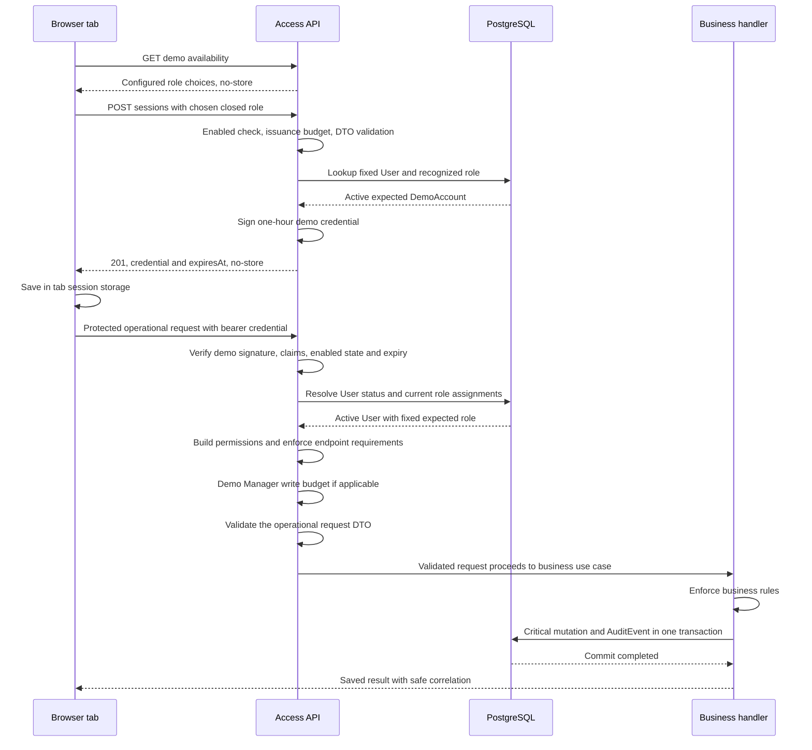

# DemoAccount sessions and server permissions

This standalone case implements
[#20](https://github.com/EPraz/keelwatch/issues/20), inspected at repository
`221e77e` on 2026-10-14. It follows the existing browser/Access/API boundaries,
including Auth0, issued demo sessions, lifecycle, shared attribution and usage
budgets. The [architecture](./ARCHITECTURE.md), [data map](./DOMAIN_MODEL.md) and
[decision index](./architecture/decisions/README.md) provide the wider context.
No credentials, new runtime, identity model or provider drill are introduced.

## Identity is not a permission or an individual visitor

| Term                | Meaning in the implemented system                                                                                                           |
| ------------------- | ------------------------------------------------------------------------------------------------------------------------------------------- |
| User                | Keelwatch access identity with external subject, active/inactive status and local role assignments. Display name/email do not grant access. |
| DemoAccount         | One of two fixed synthetic Users, distinct from normal Auth0 Users. Its recognized role must match Manager or Auditor exactly.              |
| Visitor             | A person exploring the shared demo; not a provisioned personal User or isolated tenant. Multiple visitors can use the same DemoAccount.     |
| CrewMember          | Synthetic planning/qualification profile; no relationship granting application access.                                                      |
| MaintenanceAssignee | An eligible active User responsible for an order; not CrewMember, and assignment does not create a permission.                              |

These distinctions follow the [glossary](../../GLOSSARY.md). A new demo credential
does not create a visitor-specific account. Operational changes persist and are
visible to other visitors. AuditEvent identifies the account actor and successful
fact, not the individual person, browser, tab or unique session holder. Its
correlation ID helps trace a request, but is not personal identity. Closing the tab
or switching to Auditor does not undo Manager writes or reset the shared dataset.

## Two identity paths, one protected-request boundary

Normal sign-in uses the [OIDC provider bridge](../../apps/web/src/auth/oidc-auth-provider.tsx)
and the accepted Auth0 Authorization Code with PKCE flow. The SDK redirects to
the provider and uses the callback at `/auth/callback`; the browser requests an
access token for the configured API audience. Keelwatch does not collect/store an
Auth0 password or put a client secret in the SPA. PKCE ties code exchange to the
requesting public client; see the
[official flow](https://auth0.com/docs/get-started/authentication-and-authorization-flow/authorization-code-flow-with-pkce).
The API consumes an **access token**, not an ID token as a substitute for API access.

The [OIDC verifier](../../apps/api/src/access/infrastructure/oidc-identity.verifier.ts)
uses JWKS and RS256, configured issuer/audience and `jwtVerify`, and requires a
subject. Existing valid/expired-token tests cover that boundary. Normal Auth0
token/session lifetime is provider/SDK configuration, not the demo's hard-coded
one-hour lifetime. Keelwatch business permissions are not read from an Auth0 role
or scope claim: after token verification, the local User/roles are authoritative.
The [official validation guide](https://auth0.com/docs/secure/tokens/access-tokens/validate-access-tokens)
explains API-targeted validation; Keelwatch's application-owned RBAC is the accepted
decision, not a claim of using Auth0 scopes as its business permission store.

Demo entry instead calls `GET /api/v1/access/demo`, then explicitly selects
Manager or Auditor and calls `POST /api/v1/access/demo/sessions`. The public
[controller](../../apps/api/src/access/http/demo-access.controller.ts) accepts only
the closed role value; unknown fields/subjects or elevated roles are rejected.
Availability advertises configured roles when enabled, **not** account readiness:
only issuance checks that the corresponding User exists, is active and retains
its expected fixed role. The response contains a temporary credential and
`expiresAt`; no password or signing secret is returned. Availability and issuance
use `Cache-Control: no-store`.

[DemoSessions](../../apps/api/src/access/application/demo-sessions.ts) issues a
distinctly prefixed, typed HS256-signed JWT using a server-only key. It carries
subject, issuer, audience, issued-at, expiration and a unique identifier. Its
allowed subject is server-selected; permissions are subsequently computed from
the account. Verification checks the demo format, enabled state, signature,
issuer/audience/type, required claims, age and exactly 3600 seconds between issued
and expiry times. The identifier is not a persisted revocation list.

The [configured verifier](../../apps/api/src/access/infrastructure/configured-identity.verifier.ts)
routes demo-prefixed credentials to demo validation and normal credentials to the
configured external verifier. Reserved demo subjects cannot be supplied through
the normal verifier to impersonate DemoAccounts. Server
[environment validation](../../apps/api/src/config/environment.ts) requires OIDC,
Prisma-backed Access, database configuration and secure production origins.
The local deterministic adapter is excluded in production; the
[web configuration](../../apps/web/src/auth/auth.config.ts) also disables local
identity controls in production builds. Public demo sessions are an explicit
server-issued path, not those development identities made public.

## Session issuance through the protected request

The sequence shows successful demo issuance and one subsequent critical operational write.
A protected read follows the same identity/user/permission checks, without the
operational write-budget step. Invalid branches below return before mutation.

The global guard order in [AccessModule](../../apps/api/src/access/access.module.ts)
is authentication, permissions, then demo-write budget. DTO validation follows
guards before the controller/handler; business rules follow DTO validation.
The [authentication guard](../../apps/api/src/access/http/authentication.guard.ts)
loads a User through the [Access repository](../../apps/api/src/access/infrastructure/prisma-access-user.repository.ts)
on **every protected request**, checks active status and the fixed demo role, and
builds an actor using the recognized roles. The
[permission guard](../../apps/api/src/access/http/permission.guard.ts) requires
every declared endpoint permission. Public availability/issuance and health are
explicit exceptions to authentication; issuance still has its own enabled/budget
and account checks. A valid credential alone does not permit an arbitrary operation.

`GET /api/v1/access/me` returns the active account's display profile, roles and
permissions. The [web profile loader](../../apps/web/src/access/use-current-user.ts)
and [shell](../../apps/web/src/pages/app-shell-page.tsx) use that result for controls.
Client hints can become stale; the next API call still resolves current server
grants. Browser storage/claimed expiry and hidden controls are not the security
boundary, and successful response casts do not replace server authentication.

## Fixed demo permissions and denied administration

The source of grants is the
[application mapping](../../apps/api/src/access/domain/permissions.ts), not a
per-visitor grant, assignee field or trusted browser payload.

| Capability                                 | Demo Manager                                                               | Demo Auditor              |
| ------------------------------------------ | -------------------------------------------------------------------------- | ------------------------- |
| Fleet/Compliance records and read models   | fleet:read and fleet:write; operational writes permitted under their rules | fleet:read; writes denied |
| Crew profiles, qualifications and planning | crew:read and crew:write                                                   | crew:read                 |
| Maintenance                                | maintenance:read and maintenance:write                                     | maintenance:read          |
| Activity/history                           | activity:read, plus any feature-specific required reads                    | Same read boundary        |
| User/role administration                   | No access:manage                                                           | No access:manage          |

Endpoint policies can require more than one grant: Crew planning needs Fleet
context; Maintenance history additionally requires Activity access. The two demo
accounts cannot select Platform Administrator or attach additional privileges.
Changing/mixing recognized account roles makes issued demo requests fail the
fixed-role check, not silently become an elevated session.

AccessController exposes the profile read, not a production user/role administration
workflow. The existing [HTTP authorization tests](../../apps/api/test/demo-access.integration.spec.ts)
add an **isolated test controller** requiring `access:manage` to prove both demo
roles receive `403`. That is evidence of the permission boundary, not a claim that
an administration endpoint was added to the deployed product.

## One-hour lifecycle, reload and explicit role change

The [storage adapter](../../apps/web/src/auth/demo-session-storage.ts) keeps the
issued credential/expiry in this tab's `sessionStorage`. It restores only a
well-shaped, unexpired record on reload. It ignores invalid JSON without deleting
that stored value; parsed malformed/expired records are removed when possible.
This is browser state, not server validation: tampering with storage
does not manufacture a valid signed credential or change account grants.

[DemoAuthProvider](../../apps/web/src/auth/demo-auth-provider.tsx) checks expiry with
a timer, focus/visibility events and before returning a credential. At expiry it
clears demo state/storage, removes the protected workspace and asks for another
explicit account choice. Background timers/client clocks can vary; the API's signed
expiry check remains authoritative. It does not silently issue another demo
session or extend the same one on activity. Reload does not restart the one-hour
lifetime and does not preserve an unsaved operational form as a server record.

To change from Manager to Auditor, explicitly sign out, then select Auditor.
The provider clears tab credential/state, aborts pending issuance and switches the
keyed workspace between demo/normal contexts; protected views, profile/permission
state and open forms are removed before re-entry. If normal OIDC and demo sessions
are both present, it reports misconfiguration and refuses to return a credential
until sign-out resolves the conflict. If storage cleanup fails, it reports local
sign-out and asks for the tab to be closed to clear the saved demo state.

Demo logout has **no server-side revocation call or per-session denylist**. A copied
issued credential can remain valid until expiry while demo is enabled and the
account/key remain acceptable. No promise is made that tab closure, OIDC sign-out,
new issuance or role selection revokes previously issued demo credentials. Normal
sign-out delegates to the OIDC SDK/provider; that path is not a blanket API token
revocation guarantee either.

Setting server demo access false and restarting hides availability, refuses new
issuance (`403 DEMO_ACCESS_DISABLED`) and rejects existing demo credentials on
protected requests (`401 INVALID_ACCESS_TOKEN`). Valid configured OIDC access
continues through its separate path. A normal API restart with unchanged enabled
state/key does not, by itself, revoke an otherwise valid demo credential or restart
its expiry. This follows the stateless verifier; it is not a new provider restart
experiment or persistent session-store guarantee.

| Failure boundary                            | Current observable response                                                                   |
| ------------------------------------------- | --------------------------------------------------------------------------------------------- |
| Missing/malformed bearer                    | 401 AUTHENTICATION_REQUIRED.                                                                  |
| Tampered/expired/disabled demo credential   | 401 INVALID_ACCESS_TOKEN.                                                                     |
| Valid credential, User not found            | 403 ACCESS_USER_NOT_PROVISIONED.                                                              |
| Inactive User                               | 403 ACCESS_USER_INACTIVE.                                                                     |
| Fixed demo role no longer matches           | 403 DEMO_ACCOUNT_UNAVAILABLE.                                                                 |
| Valid account lacks endpoint permission     | 403 PERMISSION_DENIED before demo write budget/handler.                                       |
| Public invalid/elevated issuance selection  | 400 validation failure; an enabled issuance attempt can consume budget before DTO validation. |
| Issuance account absent/inactive/wrong role | 403 DEMO_ACCOUNT_UNAVAILABLE; no session is issued.                                           |

The shell's [access failure state](../../apps/web/src/access/access-states.tsx)
keeps safe error/correlation feedback: forbidden entry offers return to sign-in;
other profile failures can retry the read. API rejection after account change does
not imply the browser immediately deletes storage or receives a push revocation.
No admin/account provisioning operation is added by this walkthrough.

## Attempt budgets, not distributed quotas or successful-write counters

[DemoUsageBudget](../../apps/api/src/access/application/demo-usage-budget.ts)
starts a fixed window when the first attempt arrives after a reset/expired window.
It counts accepted attempts until the configured maximum, then returns remaining
whole seconds for Retry-After. This is not a sliding window or a per-person limit.

| Budget                                                                            | Defaults and configuration                                                                                                               | What consumes it                                                                                                                                     |
| --------------------------------------------------------------------------------- | ---------------------------------------------------------------------------------------------------------------------------------------- | ---------------------------------------------------------------------------------------------------------------------------------------------------- |
| [Session issuance](../../apps/api/src/access/http/demo-session-issuance.guard.ts) | 30 attempts / 60 seconds, globally per API process; DEMO_SESSION_LIMIT and DEMO_SESSION_WINDOW_SECONDS                                   | Enabled issuance requests before DTO/account validation, including malformed role payloads. Disabled issuance is rejected before taking this budget. |
| [Manager operational writes](../../apps/api/src/access/http/demo-write.guard.ts)  | 60 attempts / 3600 seconds shared by all Manager visitors/credentials in one API process; DEMO_WRITE_LIMIT and DEMO_WRITE_WINDOW_SECONDS | Authenticated, permitted Manager POST/PUT/PATCH/DELETE on endpoints declaring a :write permission, before DTO and business rules.                    |

Changing role, logout and new issuance do not reset the Manager write counter.
Expiry of the configured window or recreation of the API process does. Counters
are in guard memory, not PostgreSQL; multiple instances have independent budgets.
Restart resetting them is an implemented limitation, not durable abuse prevention.
It does not reset persisted records, successful audit events or token lifetime.
Normal Auth0 Users do not consume this demo write budget. Reads remain subject to
authentication/permissions but do not consume that write counter.

| Operational result                                            | Write-attempt budget                                | Persistent operational change / success history                                                                  |
| ------------------------------------------------------------- | --------------------------------------------------- | ---------------------------------------------------------------------------------------------------------------- |
| Successful critical Manager write                             | Consumed                                            | Existing module mutation + audit commit together.                                                                |
| Authorized Manager DTO/business failure, including 400 or 409 | Consumed                                            | No successful mutation/history fact.                                                                             |
| Authorized no-op or same-reason cancellation repeat           | Consumed                                            | Existing no-op/idempotency semantics still apply; no second success event merely because an attempt was counted. |
| Authentication/permission refusal                             | Not consumed                                        | Handler is not permitted to mutate.                                                                              |
| Authorized GET / normal Auth0 write                           | Not consumed by this counter                        | Read is unchanged; normal write still follows its own business/audit rules.                                      |
| Exhausted budget                                              | Refused with 429 DEMO_WRITE_LIMITED and Retry-After | No handler mutation; existing state/history remain.                                                              |

The write budget also covers the existing notification-job trigger. That route
can create/return a run and schedule reconciliation; it does not itself append an
operational AuditEvent. The counter therefore measures attempts, not audit volume;
see the [job controller](../../apps/api/src/compliance/http/compliance-notification.controller.ts)
and its [persistence](../../apps/api/src/compliance/infrastructure/prisma-notification.repository.ts).

Session exhaustion uses `429 DEMO_SESSION_LIMITED`, Retry-After and a safe retry
message. The sign-in UI retains the selected role for explicit “Try demo again”;
pending issuance disables duplicate entry controls. A write-limit Toast keeps
form values for a later explicit attempt with the **same** session; obtaining
another credential does not bypass the counter. Expected errors do not become
successful Activity entries. No new permanent metrics/traces or audit-of-every-
attempt store is implied.

## Decisions, consequences and provider limits

[ADR-0003](./architecture/decisions/0003-oidc-and-application-rbac.md) preserves
standard identity plus application RBAC; provider deferral was resolved by
[ADR-0004](./architecture/decisions/0004-auth0-as-hosted-oidc-provider.md).
[ADR-0008](./architecture/decisions/0008-public-demo-access.md) explicitly adds
public shared accounts without replacing Auth0 or production guards. Both demo
roles were published and owner-accepted on 2026-10-11; original ADR dates,
alternatives and historical provisioning wording remain navigable in the index.
No new identity ADR is needed to restate those decisions.

The trade-off is simple public exploration with real server permissions and no
published password, at the cost of shared data/attribution and bounded, process-local
controls. Signature validity, active status, role and permission are separate
checks; neither a signed token nor a disabled UI button is sufficient alone.
Per-request lookup permits changed account state to affect subsequent calls, but
does not freeze User grants throughout a concurrent business transaction or add
per-session immediate revocation. Shared quotas can affect unrelated visitors.

Normal Auth0 login and uncached/rotated JWKS retrieval depend on provider reachability.
The OIDC verifier keeps a JWKS resolver in process, so an already usable cached key
may permit an existing unexpired token; this is conditional behavior, not a tested
provider-outage SLA. Demo cryptographic verification does not call Auth0, but account
lookup/issuance still depend on PostgreSQL and API configuration. The SPA also
composes the normal provider beneath demo state, so independent API verification
does not prove end-to-end browser usability during an Auth0 outage. Database loss
does not produce simulated successful authorization or writes. #20 induces no
provider failure, public login or quota exhaustion to claim stronger availability.

## Directed evidence reading

| Existing evidence                                                                                                                                                      | Observable boundary to inspect                                                                                                                                                                                                                               |
| ---------------------------------------------------------------------------------------------------------------------------------------------------------------------- | ------------------------------------------------------------------------------------------------------------------------------------------------------------------------------------------------------------------------------------------------------------ |
| [Demo HTTP integration](../../apps/api/test/demo-access.integration.spec.ts)                                                                                           | One-hour issuance, fixed roles, tampered/expired/disabled credentials, invalid/elevated selections, issuance concurrency, denied writes/admin test policy and write budgets after authorization.                                                             |
| [Demo PostgreSQL integration](../../apps/api/test/demo-access.postgres.integration.spec.ts)                                                                            | Distinct provisioned accounts, shared Manager changes/Activity seen by Auditor, existing operational workflows, fresh credentials retain write budget, refused writes preserve state, inactive/unprovisioned/elevated account rechecks and OIDC coexistence. |
| [OIDC verifier tests](../../apps/api/src/access/infrastructure/oidc-identity.verifier.spec.ts) and [Access HTTP tests](../../apps/api/test/access.integration.spec.ts) | Synthetic JWKS signature/expiry boundary, current-user mapping, active status and role denial. These are not provider-outage tests.                                                                                                                          |
| [Demo React tests](../../apps/web/src/auth/demo-access.test.tsx)                                                                                                       | Issuance, reload, logout/expiry, pending duplicate prevention, availability failure/malformed session, chosen-role retry and simultaneous OIDC/demo conflict.                                                                                                |
| [Manager React tests](../../apps/web/src/auth/demo-manager.test.tsx)                                                                                                   | Manager-to-Auditor cleanup of profile/permissions/draft, reloaded role, fixed expiry and retained inputs after a write limit with the same credential.                                                                                                       |

Read HTTP/persisted authorization outcomes before UI presentation behavior. React
fixtures simulate responses and the OIDC SDK; PostgreSQL tests use synthetic
identities and an isolated JWKS fixture rather than a provider outage. Application
HTTP/PostgreSQL results and the [Phase 5 public journey record](./DEMO_JOURNEY_QA.md)
remain their existing evidence with its limits, not new public acceptance or
database runs for #20. Current local rendering, reference/source checks and executed
gates are recorded in [progress](../progress.md); personal practice Q&A is excluded.
