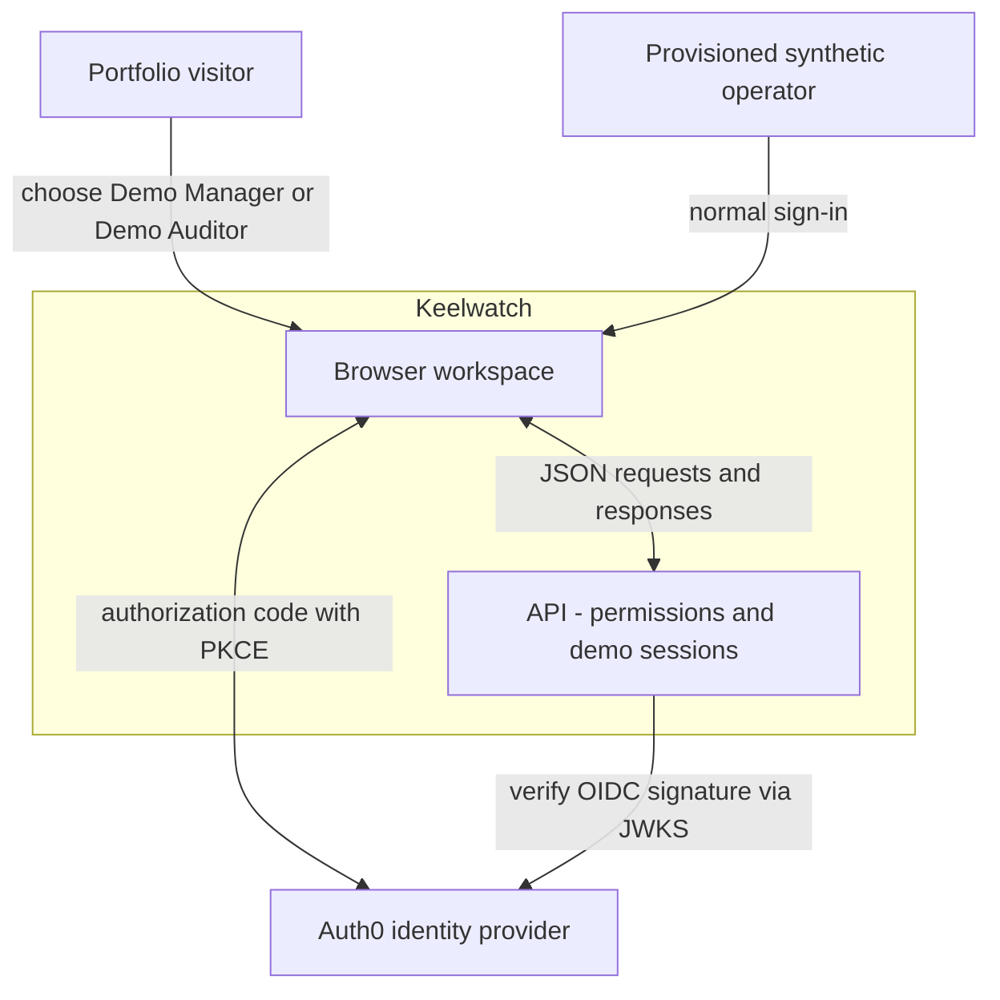
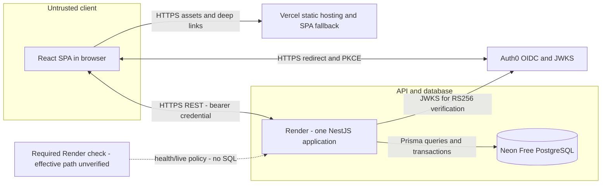
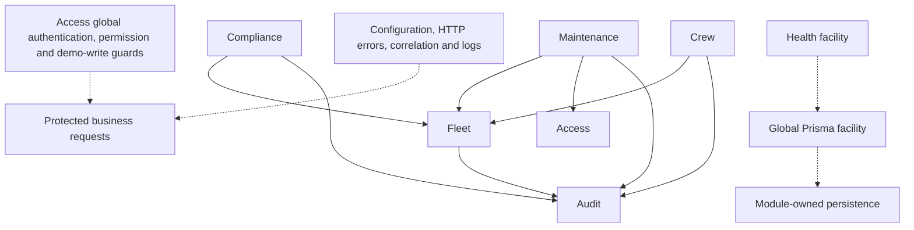

# Current architecture — Keelwatch

Evidence baseline: repository `748310a`, inspected 2026-10-14 for
[#17](https://github.com/EPraz/keelwatch/issues/17). These versioned diagrams describe
implemented boundaries. Start with the [reviewer entry](./README.md),
[data map](./DOMAIN_MODEL.md) and [decision index](./architecture/decisions/README.md).

## Context and trust boundaries



The browser is outside the authorization boundary. Both identity paths reach
Access, which resolves a local active User and application permissions on each
protected request. Auth0 owns normal login credentials, not Keelwatch roles.
DemoAccounts are two fixed synthetic Users with distinct Manager/Auditor roles;
visitors share those accounts, data and account-level Activity. CrewMember is a
planning profile, not User; MaintenanceAssignee is an eligible User, not CrewMember.
See [project vocabulary](../../GLOSSARY.md).

The [authentication guard](../../apps/api/src/access/http/authentication.guard.ts)
rejects missing/invalid credentials, unknown or inactive Users, and changed demo
roles. The [permission guard](../../apps/api/src/access/http/permission.guard.ts)
enforces declared endpoint permissions using
[server grants](../../apps/api/src/access/domain/permissions.ts). Manager writes
operational records; Auditor reads; neither demo role gets `access:manage`.
Compliance uses Fleet permissions rather than a separate Compliance grant.
The [configured verifier](../../apps/api/src/access/infrastructure/configured-identity.verifier.ts)
selects the demo or configured external identity path. Production
[configuration validation](../../apps/api/src/config/environment.ts) prohibits
the local development adapter and requires OIDC and Prisma-backed access.

[DemoSessions](../../apps/api/src/access/application/demo-sessions.ts) signs and
verifies one-hour credentials with a server-only secret. The browser stores its
credential in [tab session storage](../../apps/web/src/auth/demo-session-storage.ts):
reload preserves it, expiry requires explicit sign-in, and logout clears client
state before selecting another role. Clearing storage does not revoke a copied
credential server-side. Disabling demo access and restarting rejects demo
credentials while preserving the configured OIDC path. Issuance and Manager write
budgets are process-local, shared and reset on restart; see
[ADR-0008](./architecture/decisions/0008-public-demo-access.md) and the
[configuration guide](../../README.md#optional-password-free-demo-access).

## Current deployment and containers



The dashed probe edge is the required health-check policy, not verification of the
effective Render dashboard setting. Vercel serves the SPA; the existing Render API
connects to Neon Free. This is
the owner-reported deployment, supported by the recorded public smoke and
[Phase 5 CI](https://github.com/EPraz/keelwatch/actions/runs/38195645157).
The [progress record](../progress.md#publicación-autorizada-de-fase-5-e-inicio-de-entrevista-de-fase-6)
distinguishes Vercel's verified source SHA from Render's unverified deployed SHA.
These diagrams do not establish current provider regions, instance sizes, idle
settings, suspension, backups or availability guarantees. No provider dashboard
or public database is accessed for this documentation slice.

[HealthController](../../apps/api/src/health/health.controller.ts) exposes public
`/api/v1/health/live` (process-only) and `/api/v1/health/ready` (`SELECT 1` when
Access uses Prisma). Liveness cannot prove database availability or a deployed
commit; readiness checks a connection, not every workflow. The
[runbook](../deployment.md#despliegue-existente-con-neon-free) requires automatic
liveness checks to avoid periodic database queries; the effective manually
configured Render path has not been independently inspected. A readiness response
does not prove whether Neon was suspended or woke up. The
[bounded measurement](./DEMO_PERFORMANCE.md) separates initial liveness delay from
later reads and cannot attribute either to a confirmed provider or SQL bottleneck.

The paid all-Render [Blueprint](../../render.yaml) and
[ADR-0005](./architecture/decisions/0005-hosting-options-and-decision-gate.md)
preserve earlier preparation, not the current topology or spending authority.
There are no active attachment services, maritime integrations, email/SMS delivery,
managed queues, Redis or distributed workers.

## Six business modules in one API

Solid arrows denote explicit Nest module imports, from consumer to dependency.
Dashed arrows denote global facilities, not business-module imports.



[AppModule](../../apps/api/src/app.module.ts) composes Access, Fleet, Compliance,
Crew, Maintenance, Health, configuration and global Prisma. Audit is imported
through its consumers, not separately listed at the root.

| Module and composition source                                       | Responsibilities and actual seam                                                                                                                                               |
| ------------------------------------------------------------------- | ------------------------------------------------------------------------------------------------------------------------------------------------------------------------------ |
| [Access](../../apps/api/src/access/access.module.ts)                | Identity verification, active Users, role-to-permission mapping, demo issuance/budgets; exports AccessService and MaintenanceAssigneeDirectory. No business module imports.    |
| [Fleet](../../apps/api/src/fleet/fleet.module.ts)                   | Vessel create/update/list/detail and Activity composition; exports FleetService and its repository token. Depends on Audit.                                                    |
| [Compliance](../../apps/api/src/compliance/compliance.module.ts)    | Certificate catalog/records, edits/archive, UTC-derived queue and Overview inputs, notification reconciliation/run status. Reads Fleet through FleetService; depends on Audit. |
| [Crew](../../apps/api/src/crew/crew.module.ts)                      | Profiles, dated qualifications, assignment reservation/cancellation, derived requirement evaluation and date-specific composition. Depends on Fleet and Audit.                 |
| [Maintenance](../../apps/api/src/maintenance/maintenance.module.ts) | Order create/edit/lifecycle/history. Uses FleetService, Access's eligible-user directory and Audit writer/history reader.                                                      |
| [Audit](../../apps/api/src/audit/audit.module.ts)                   | Sanitized event writer and scoped Activity/history readers. Does not depend on another business module or replay domain state.                                                 |

Configuration, Prisma, HTTP middleware/filters/interceptors and Health are technical
facilities. Module-owned ports/adapters exist where implemented; this is not a
uniform repository abstraction for every use case. For example,
[MaintenanceService](../../apps/api/src/maintenance/application/maintenance.service.ts)
uses Prisma directly for creation/reads and dedicated persistence collaborators
for editing and lifecycle. Access's directory owns User eligibility reads. Shared
Prisma transactions let operational writes and AuditEvent commit or roll back
together without a second service or message broker.

[Vessel Activity](../../apps/api/src/audit/infrastructure/prisma-audit-event.reader.ts)
combines direct Vessel events with Certificate and retained CertificateDocument
events via sanitized `vesselId` metadata; Maintenance events are included when
permitted. Crew assignment events use Vessel context directly. These are scoped
associations, not foreign keys from AuditEvent to each resource.

## Implemented web and repository organization

```text
apps/web/src/
  app/        routing, ProtectedRoute, AppErrorBoundary, Toast/ToastProvider
  auth/       OIDC, demo and local providers; tab credential lifecycle
  access/     current-user loading and access states
  pages/      shell, sign-in/callback, Overview and not-found
  features/   fleet/, compliance/, crew/, maintenance/
  styles/     shared tokens, foundations and feature styles
  test/       test setup
```

[App](../../apps/web/src/app/app.tsx) provides routes; the
[auth composition](../../apps/web/src/auth/auth-root.tsx) owns identity state.
Feature hooks coordinate reads, forms and refreshes using React state/effects and
AbortSignals. Feature `*.api.ts` files maintain fetch transport and error handling.
There is no central generated client, `shared/api`, standalone Activity feature,
or shared backend DTO package. Components reuse shared CSS and Toast feedback;
expected read/form failures have recovery states, while AppErrorBoundary handles
unexpected rendering failures.

OpenAPI describes the REST boundary. Swagger UI is configured only outside
production in [configureApplication](../../apps/api/src/configure-application.ts).
Three selected web contract files are generated/verified against Swagger in
existing PostgreSQL tests:

| Selected contract                                                                         | Existing synchronization evidence                                                                   |
| ----------------------------------------------------------------------------------------- | --------------------------------------------------------------------------------------------------- |
| [RequirementEvaluation](../../apps/web/src/features/crew/requirement-evaluation.types.ts) | [Evaluation contract test](../../apps/api/test/requirement-evaluation.postgres.integration.spec.ts) |
| [CrewComposition](../../apps/web/src/features/crew/composition.types.ts)                  | [Composition contract test](../../apps/api/test/composition.postgres.integration.spec.ts)           |
| [Maintenance types](../../apps/web/src/features/maintenance/maintenance.types.ts)         | [Maintenance contract test](../../apps/api/test/maintenance.postgres.integration.spec.ts)           |

Other feature types and some request inputs remain hand-maintained. The
[test helper](../../apps/api/test/requirement-evaluation-contract.ts) renders selected
schema types; it does not generate a universal SDK. Successful JSON responses are
cast to TypeScript types by the
[Fleet](../../apps/web/src/features/fleet/fleet.api.ts) and
[Maintenance](../../apps/web/src/features/maintenance/maintenance.api.ts) transports,
not generally validated against a runtime schema. Static contract synchronization
does not provide runtime response validation.

The root npm workspace contains `apps/web`, `apps/api`, `scripts`, `docs`,
optional `infra/compose.yaml`, and `.github/workflows/quality.yml`. There are no
`packages/eslint-config`, `packages/tsconfig` or `packages/contracts` directories.
The ADRs live under `docs/flagship/architecture/decisions`, and operational guidance
in `docs/deployment.md`; these are the implemented paths.

## Request, consistency and failure boundaries

Protected writes pass through authentication, endpoint permissions and the demo
write budget before DTO validation. Server cases then enforce domain rules;
critical operational changes share a database transaction with AuditEvent.
The HTTP boundary rejects undeclared DTO properties and uses a safe error
envelope with stable code, message, optional field errors and correlation ID.
The client supplies a correlation ID for writes; the server validates or generates
one. Success/failure Toasts and field feedback preserve usable recovery without
scrolling the page to announce an operation result.

Crew creation/cancellation serializes per profile at ReadCommitted before checking
inclusive periods across vessels. Maintenance edits/transitions lock a scoped
order, compare `expectedRevision`, and condition the revision-incrementing update.
Neither mechanism is lock-free. See the [data invariants](./DOMAIN_MODEL.md).
The [Maintenance case](./MAINTENANCE_CASE.md) traces competing edits, lifecycle,
audit and recovery for #18. The [Crew case](./CREW_CASE.md) traces reservation,
cancellation and qualification coverage for #19, with its application/SQL limits.

[NotificationJobService](../../apps/api/src/compliance/application/notification-job.service.ts)
serializes scheduled executions through a promise chain in one API process.
[Notification persistence](../../apps/api/src/compliance/infrastructure/prisma-notification.repository.ts)
reconciles conditions and completes a run atomically. Database partial unique
indexes bound active runs/conditions, but do not provide a durable scheduler,
distributed lease or automatic recovery of interrupted runs on startup.

| Boundary                     | Implemented behavior and limit                                                                                                                                                                                                                                                        |
| ---------------------------- | ------------------------------------------------------------------------------------------------------------------------------------------------------------------------------------------------------------------------------------------------------------------------------------- |
| Authentication/authorization | Invalid/expired token is `401`; unprovisioned/inactive account or missing permission is `403`. See [Access HTTP tests](../../apps/api/test/access.integration.spec.ts) and [demo HTTP tests](../../apps/api/test/demo-access.integration.spec.ts).                                    |
| Validation/conflict          | DTO/domain failures use `400`; missing scoped resource uses `404`; uniqueness, lifecycle or revision conflicts use `409`; quota refusal uses `429` and Retry-After. Not every feature uses every code.                                                                                |
| Audit failure                | Critical write rolls back; [Fleet](../../apps/api/test/fleet.postgres.integration.spec.ts), [Crew](../../apps/api/test/assignment-atomicity.postgres.integration.spec.ts) and [Maintenance](../../apps/api/test/maintenance.postgres.integration.spec.ts) already exercise atomicity. |
| Database failure             | No simulated successful persistence; readiness and database-dependent operations fail. Liveness remains process-only.                                                                                                                                                                 |
| OIDC provider failure        | New login or uncached JWKS retrieval can fail. Cached signing keys may permit existing unexpired tokens; token validity and active-user lookup still apply. No blanket outage-survival guarantee.                                                                                     |
| Browser/session failure      | Recoverable reads can retry; drafts survive ordinary expected form conflicts. Expiry/logout clears the authenticated workspace; there is no general draft-preservation promise across sign-out.                                                                                       |

[HTTP logging](../../apps/api/src/common/http/http-logging.interceptor.ts) records
method, path, status, duration, correlation ID and safe internal actor ID.
These structured logs and health checks are not an exported metrics/tracing
platform or an availability guarantee. Production secrets stay in server
configuration; browser `VITE_` configuration is public. CORS/Helmet/DTO validation
complement server authorization, rather than replacing it.

Existing quality commands and CI evidence are listed in the
[root README](../../README.md#quality-gates). This documentation slice verifies
diagrams, references and source agreement locally; it does not deploy, seed,
query the public database or repeat the public measurement.
