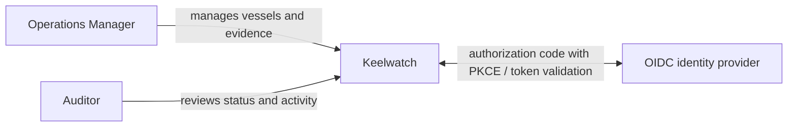
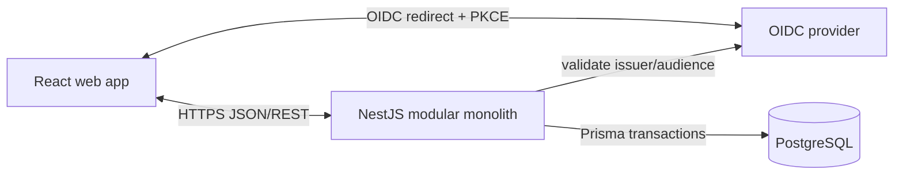

# Arquitectura inicial — Keelwatch

Estado: implementada hasta la reconciliación idempotente de notificaciones

Alcance: primera release; no describe una plataforma hipotética a gran escala

## Drivers

- Mostrar un flujo full-stack inspeccionable.
- Mantener reglas y ownership por dominio.
- Probar permisos y estados de fallo.
- Desplegar con costo y operación razonables para un portfolio.
- Permitir evolución sin pagar desde hoy la complejidad de microservicios.

## Contexto



No existen integraciones marítimas reales en la primera release. Emails, object
storage externo, colas administradas y proveedores regulatorios siguen fuera del
límite actual. El job de notificaciones es un runner acotado dentro del proceso API.

## Contenedores



- **Web:** presentación, interacción, routing y estado de cliente. Nunca decide la
  autorización final.
- **API:** contratos REST, autorización, casos de uso, reglas y coordinación de
  transacciones.
- **Database:** integridad, persistencia y consultas.
- **Identity provider:** credenciales y protocolo de autenticación; no contiene
  permisos de negocio como fuente de verdad.

## Módulos del backend

```text
Access
├─ External identity mapping
├─ User status
└─ Role assignments and authorization policies

Fleet
├─ Register vessel
├─ Update vessel
└─ Query fleet / vessel detail

Compliance
├─ Certificate catalog
├─ Register certificate
├─ Edit / archive certificate with atomic audit
├─ Query complete certificate history
├─ Derive current compliance status in server UTC
├─ Query the fleet-wide derived queue with filters and pagination
├─ Reconcile persistent expiry notifications idempotently
└─ Expose bounded job status and an authorized notification watch

Audit
├─ Append sanitized event
└─ Query permitted activity
```

Dependencias permitidas:

- Compliance consulta Fleet mediante una interfaz pública del módulo.
- Fleet no depende de Compliance para existir.
- Access es usado por los casos de uso, pero no importa módulos de negocio.
- Audit recibe un contrato explícito y no contiene lógica de negocio ajena.
- Ningún módulo accede al repository privado de otro.

El detalle de Fleet compone Activity con eventos propios de Vessel y eventos de
Certificate cuyo metadata sanitizado referencia esa embarcación. Compliance no
escribe tablas de Fleet y Fleet no recalcula reglas de Compliance.

El runner de notificaciones se serializa dentro de una instancia de API y una
constraint parcial de PostgreSQL impide más de un run `QUEUED`/`RUNNING` para el
job. Otra constraint parcial garantiza una sola notificación no resuelta por
condición estable. Cada ejecución vuelve a derivar el estado actual, conserva las
condiciones iguales, crea las nuevas y resuelve las que desaparecieron. Esta
decisión demuestra idempotencia sin introducir una cola administrada antes de que
exista escala o entrega externa; una futura ejecución multi-instancia deberá usar
un worker/lease compartido.

## Organización del frontend

```text
apps/web/src/
├─ app/                  # composition, routing and providers
├─ features/
│  ├─ access/
│  ├─ fleet/
│  ├─ compliance/
│  └─ activity/
├─ shared/
│  ├─ ui/               # primitives with demonstrated reuse
│  ├─ api/              # generated client and transport policy
│  └─ errors/           # route/feature error boundaries
└─ styles/              # tokens and global foundations
```

- Feature folders poseen componentes, hooks, schemas de formulario y tests de
  su comportamiento.
- Server state y UI state permanecen separados.
- El cliente se genera o valida desde OpenAPI; no se mantiene un segundo contrato
  manual compartido.
- Error boundaries aíslan rutas o widgets recuperables; no reemplazan el manejo
  de errores esperado en formularios.
- Memoization se introduce por medición o identidad estable, no como decoración.

## Organización del repositorio

Un único repositorio independiente utiliza npm workspaces sin Nx/Turborepo al
inicio:

```text
keelwatch/
├─ apps/
│  ├─ web/
│  └─ api/
├─ packages/
│  ├─ eslint-config/     # solo si ambas apps requieren reglas compartidas
│  └─ tsconfig/          # solo si evita duplicación real
├─ docs/
│  ├─ architecture/
│  ├─ decisions/
│  └─ runbooks/
├─ infra/
│  └─ compose.yaml
├─ package.json
└─ README.md
```

No se creará `packages/contracts` para duplicar DTOs. OpenAPI será el contrato
entre web y API.

## Flujo de una escritura

1. React valida para feedback inmediato, sin confiar en esa validación.
2. El cliente envía token y correlation ID.
3. NestJS autentica y aplica política RBAC.
4. El DTO valida la forma de entrada.
5. El caso de uso normaliza datos y ejecuta reglas.
6. Prisma ejecuta cambio y AuditEvent dentro de una transacción.
7. La API devuelve representación y correlation ID.
8. El cliente invalida/refresca queries relacionadas y mueve foco al resultado.

## Contratos de error

- `400/422`: forma o regla inválida con errores por campo cuando corresponda.
- `401`: identidad ausente o inválida.
- `403`: identidad válida sin permiso.
- `404`: recurso no visible o inexistente según política anti-enumeración.
- `409`: unicidad o conflicto de estado.
- `5xx`: mensaje seguro, correlation ID y log estructurado.

Los códigos de dominio son estables; los mensajes pueden evolucionar y son
localizables en el frontend.

## Entornos

- **Local por defecto:** web y API con adaptador de identidad sintético y directorio
  Access en memoria; no requiere Docker ni PostgreSQL. Los slices persistentes usan
  una instalación nativa de PostgreSQL o una base administrada configurada de forma
  explícita.
- **Contenedores opcionales:** el archivo Compose existe solo para evaluadores que
  ya usan Docker y no define el flujo local normal.
- **CI:** PostgreSQL efímero, migraciones desde cero y tests sin secretos de
  producción.
- **Preview/production demo:** proveedor OIDC seleccionado, HTTPS, secretos
  administrados y cuentas demo limitadas.

Auth0 fue seleccionado para OIDC hospedado. Render fue seleccionado para preparar
web estática, API Node siempre activa y PostgreSQL administrado en un único
Blueprint después de comparar costo, cold start, backups, logs y eliminación.
GitHub Actions contiene el quality gate reproducible. Las decisiones y fuentes
viven en ADR-0004, ADR-0005 y el runbook de despliegue. Auth0 fue configurado y
verificado localmente por el propietario; GitHub/Render y los URLs públicos
continúan diferidos hasta su interacción y aprobación.

## Calidad inicial

El pipeline mínimo ejecutará:

```text
format/check
lint
typecheck
unit tests
integration tests
migration validation
production build
```

E2E se incorpora con el primer slice, no como tarea separada de “configurar
testing”. La API expone OpenAPI y valida que el cliente generado no esté
desactualizado.

## Seguridad inicial

- Authorization Code con PKCE para la SPA.
- Validación de issuer, audience, firma y expiración en la API.
- Roles de negocio consultados desde la aplicación.
- Deny by default en endpoints protegidos.
- CORS con origins explícitos.
- Validación y límites de payload.
- Secretos fuera del repositorio y logs.
- Dependency scanning y pruebas negativas de autorización.
- Sin cargas ni descargas de archivos según ADR-0007. Se retiran rutas y servicios
  de adjuntos; el aviso en UI no es la frontera de seguridad.

## Observabilidad inicial

- Correlation ID recibido o generado en el borde.
- Logs JSON con request, resultado, duración y actor ID interno cuando sea seguro.
- Métricas de tasa, errores y duración por endpoint.
- Health y readiness separados.
- Sin stack traces ni tokens en respuestas o logs.

No se añade tracing distribuido hasta existir más de un proceso relevante o una
pregunta de diagnóstico que logs y métricas no respondan.

## Fallos previstos

| Fallo                         | Comportamiento inicial                                                                  |
| ----------------------------- | --------------------------------------------------------------------------------------- |
| OIDC no disponible            | Sesiones existentes continúan hasta expirar; nuevos logins muestran recuperación clara. |
| PostgreSQL no disponible      | API falla readiness y devuelve error seguro; no simula escritura.                       |
| AuditEvent no puede persistir | La escritura crítica completa hace rollback.                                            |
| Web pierde conectividad       | Conserva input no sensible y permite reintentar; no muestra éxito optimista.            |
| Token expira durante edición  | Conserva destino y datos locales seguros mientras renueva sesión.                       |

## Decisiones diferidas

- Creación efectiva de recursos en GitHub y Render, más los URLs HTTPS finales en
  el tenant Auth0 existente.
- Librería concreta de server state y formularios.
- Sistema visual y biblioteca de componentes.
- Cache y realtime. Adjuntos excluidos por ADR-0007, no pendientes de activación.
- Multi-tenancy.

Diferir estas decisiones evita convertir preferencias en arquitectura. Cada una
tendrá criterio y ADR cuando el flujo la necesite.
