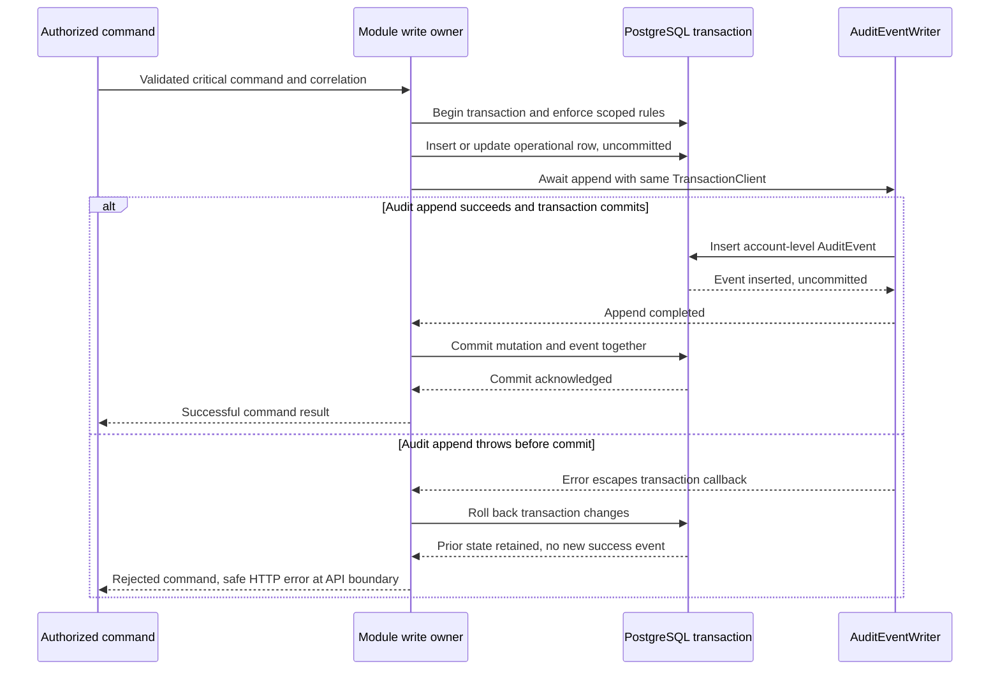

# Critical writes and audit rollback

This supporting case implements the audit half of
[#21](https://github.com/EPraz/keelwatch/issues/21), inspected at repository
`e24d316` on 2026-10-14. It explains existing Fleet, Crew and Maintenance behavior
with synthetic evidence. The separate [job case](./RECONCILIATION_CASE.md) explains
derived conditions and restart limits; neither introduces a runtime change.

## The problem and the transaction boundary

A successful operational change must retain its account-level history. Saving a
Vessel and subsequently trying to save AuditEvent in an unrelated transaction
would allow a vessel without its success record. Recording success first would
allow history for a change that never committed. The implemented boundary puts
both writes in the same PostgreSQL transaction and awaits the event append.

The [AuditEventWriter port](../../apps/api/src/audit/application/audit-event.writer.ts)
requires the caller's Prisma TransactionClient. The
[writer](../../apps/api/src/audit/infrastructure/prisma-audit-event.writer.ts) uses
that client, not a separate connection/transaction. An exception escaping the
transaction callback rejects the operation and discards its database changes.
This is atomicity: the pair commits together or neither persists. The
[PostgreSQL 17 transaction explanation](https://www.postgresql.org/docs/17/tutorial-transactions.html)
provides the underlying concept; it does not establish provider uptime or backup
capabilities for this deployment.

[ADR-0002](./architecture/decisions/0002-modular-monolith.md) already records the
single modular API/database and local critical-write/audit transaction. This case
explains its current consequences rather than creating another decision for the
same boundary. Original decision dates and reasons remain unchanged.

## One critical command, two possible outcomes

The sequence starts after authentication, current active User/permissions and DTO
validation. Each module still applies its own rules and concurrency protocol.
An injected audit exception in existing tests exercises the failure branch.

Begin/commit/rollback are managed by Prisma; these are conceptual transaction
steps, not additional SQL issued by the application. The diagram does not imply
that audit and business writes are separate services. It deliberately shows a
known pre-commit failure, not a guarantee about what a browser can infer after a
connection disappears while a commit is being acknowledged.

| Representative write owner                                                                                                                                                       | Rule and same-transaction behavior                                                                                   | Existing observable rollback evidence                                                                                                                                                                                                            |
| -------------------------------------------------------------------------------------------------------------------------------------------------------------------------------- | -------------------------------------------------------------------------------------------------------------------- | ------------------------------------------------------------------------------------------------------------------------------------------------------------------------------------------------------------------------------------------------ |
| [Fleet repository](../../apps/api/src/fleet/infrastructure/prisma-vessel.repository.ts)                                                                                          | Vessel create/edit awaits VESSEL_CREATED or VESSEL_UPDATED; registry uniqueness and edit rules still apply.          | [Fleet PostgreSQL tests](../../apps/api/test/fleet.postgres.integration.spec.ts): a rejecting writer leaves no created vessel/event; an edit preserves the original name and adds no event for its correlation.                                  |
| [Crew profile repository](../../apps/api/src/crew/infrastructure/prisma-crew.repository.ts)                                                                                      | Profile insertion and CREW_MEMBER_CREATED share one callback. CrewMember is a synthetic profile, not an access User. | [Crew PostgreSQL tests](../../apps/api/test/crew.postgres.integration.spec.ts): rejecting append leaves no profile or success event.                                                                                                             |
| [Crew assignment repository](../../apps/api/src/crew/infrastructure/prisma-assignment.repository.ts)                                                                             | Creation/cancellation uses the common profile lock and transaction; cancelled metadata and event commit together.    | [Assignment atomicity tests](../../apps/api/test/assignment-atomicity.postgres.integration.spec.ts): HTTP 500 leaves no new plan; failed cancellation retains null cancellation metadata and the reservation still blocks an overlapping create. |
| [Maintenance create](../../apps/api/src/maintenance/application/maintenance.service.ts) and [editor](../../apps/api/src/maintenance/infrastructure/prisma-maintenance-editor.ts) | Creation checks scoped vessel/assignee; edit combines lock, reviewed revision, conditional update and event.         | [Maintenance PostgreSQL tests](../../apps/api/test/maintenance.postgres.integration.spec.ts): failed create leaves list empty; failed edit retains NORMAL priority/revision 1 and only the original creation event.                              |

[Lifecycle tests](../../apps/api/test/maintenance-lifecycle.postgres.integration.spec.ts)
also check state/revision rollback on transition audit failure.
[Certificate tests](../../apps/api/test/compliance.postgres.integration.spec.ts)
exercise the same boundary for create/edit/archive. These are representative
existing tests, not a claim that every failure mode or provider outage is covered.

The Fleet/profile tests substitute a rejecting writer at the repository seam.
Assignment/Maintenance fixtures inject a failure by action through the HTTP app,
then inspect PostgreSQL. These test a real transaction with a synthetic failure
at the audit boundary; they do not disconnect Neon or corrupt production storage.
Their existing results are historical evidence, not new PostgreSQL runs for #21.

## A successful fact is different from an attempt

AuditEvent stores actorUserId, action, entity type/ID, selected metadata,
correlation and occurrence time. Call sites choose limited operational metadata;
the writer passes those strings through and is **not a universal secret scrubber**.
New callers must preserve that discipline. The
[Activity reader](../../apps/api/src/audit/infrastructure/prisma-audit-event.reader.ts)
returns a scoped, permission-controlled presentation with the actor's current
display name. Vessel Activity associates certificate and permitted Maintenance
events by metadata; resource IDs are not a universal foreign-key relationship.

The actor is the account that performed the operation. Shared Demo Manager means
multiple visitors share that attribution; it cannot identify a person, tab or
unique session. See [Access attribution and permission boundaries](./ACCESS_CASE.md).
AuditEvent is not an event-sourced aggregate, a security log of every attempt,
a cryptographically tamper-proof ledger or a replay mechanism.

| Outcome                                                                      | Operational row and successful history                                                                                             |
| ---------------------------------------------------------------------------- | ---------------------------------------------------------------------------------------------------------------------------------- |
| Permitted actual critical change commits                                     | Mutation and corresponding success event persist together.                                                                         |
| Authentication/permission refusal, invalid DTO or rejected business conflict | No successful change/event for the rejected command; safe error/correlation may be observable.                                     |
| Known audit exception before commit                                          | Transaction rejects; a new row disappears or the prior row/revision/state remains. Existing history is retained.                   |
| Accepted feature no-op or same-reason cancellation repeat                    | Existing feature semantics apply; an attempt alone does not append another success event. Stale Maintenance no-ops still conflict. |
| Response lost or browser timeout                                             | Client outcome is uncertain. A commit may already have happened; absence of a response does not prove rollback.                    |

An authorized demo write attempt can consume its process budget even when DTO
validation or the transaction later fails. That in-memory counter is not in the
database transaction. Logs likewise are not rolled back. Notification triggers
create/return runs, not operational AuditEvents; their
[reconciliation transaction](./RECONCILIATION_CASE.md) has a different purpose.
No claim is made that every POST or every API request writes AuditEvent.

## Interpreting a failure without inventing certainty

The [exception filter](../../apps/api/src/common/http/api-exception.filter.ts)
preserves expected safe error codes and turns an unexpected exception into
`500 INTERNAL_ERROR`, a generic message and correlation ID. It does not send the
internal error message/stack to the browser. Known transaction failure is different
from network uncertainty: before repeating a potentially non-idempotent create,
inspect the existing authorized record/history. The UI does not automatically
retry critical writes or use correlation as an idempotency key. The
[Maintenance](./MAINTENANCE_CASE.md) and [Crew](./CREW_CASE.md) cases explain their
specific review/cancellation recovery rather than a general exactly-once promise.

[Correlation middleware](../../apps/api/src/common/http/correlation-id.middleware.ts)
accepts only the bounded safe header syntax or generates an ID, and echoes it in
the response. It helps connect a request, safe errors and an event when one commits.
It neither grants access nor proves the requester is a unique visitor.

The [HTTP interceptor](../../apps/api/src/common/http/http-logging.interceptor.ts)
logs structured method, safe path, response status, rounded duration, correlation
and internal actor ID when available. The
[safe-path helper](../../apps/api/src/common/http/safe-request-path.ts) drops query
strings and masks the retired document-download token segment; it does not
anonymize every path identifier. Bodies, authorization headers and raw internal
error details are not part of this completion record. The exception filter logs
5xx failures with safe request fields and the error class. Guards can reject before
the interceptor is entered; this is not a claim of one completion log per request.

These facilities are local logging boundaries, not permanent exported metrics,
distributed traces or a measured incident-response service. They do not make
external side effects transactional. There is no email/SMS side effect to roll back
inside these critical operational writes.

[HealthController](../../apps/api/src/health/health.controller.ts) separates
process-only liveness from explicit readiness (`SELECT 1` for Prisma Access).
An alive API can still fail a write when PostgreSQL is unavailable. Readiness
checks a connection, not audit completeness or every table/workflow. A successful
probe does not prove Neon suspension, wake-up, backup or later availability.
The [deployment guidance](../deployment.md#despliegue-existente-con-neon-free)
requires automatic liveness, with the effective manual provider setting unverified;
this case adds no polling, fault drill or keep-alive activity.

Database loss does not produce simulated successful writes. A lost connection near
commit needs cautious interpretation rather than a universal rollback assertion.
Normal login/JWKS dependency and conditional cached-key behavior are qualified in
the [Access case](./ACCESS_CASE.md); liveness does not validate Auth0 either.
No live provider degradation experiment is evidence for #21.

## Why preserve the local transaction

| Alternative, compared now                            | Consequence for this contract                                                                                         |
| ---------------------------------------------------- | --------------------------------------------------------------------------------------------------------------------- |
| Business commit followed by independent audit append | An audit failure leaves an unaudited success unless a different recovery protocol is introduced.                      |
| Audit first, then independent business commit        | Can retain a success claim for a rejected business change.                                                            |
| Catch/ignore append failure within the callback      | Allows committing the mutation without its required event.                                                            |
| Queue audit asynchronously                           | Changes when success history exists and requires durable publication/recovery semantics; no such redesign is adopted. |

These are present-day comparisons, not invented historical rejected proposals.
The benefit is a small, inspectable atomic boundary using the existing database.
The cost is coupling command availability to audit persistence and holding the
transaction/connection through append. Atomicity does not itself solve concurrent
business conflicts: the other cases explain locks/revisions, and no live isolation,
wait-time or capacity guarantee is inferred. Direct SQL or a future caller bypassing
the protocol can bypass audit completeness; the schema does not require an event
for every operational update.

Read the writer port, one module callback, its success/negative/rollback tests,
then the Activity reader and safe error/logging boundary. Current local diagram,
reference and gate results are in [progress](../progress.md). Public fault drills,
new monitoring, personal practice questions/scripts and implementation-mirroring
tests are outside this documentation slice.
