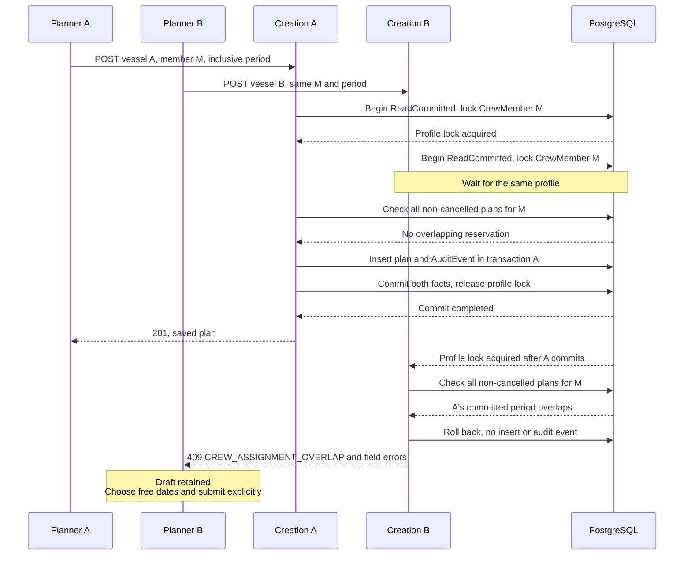
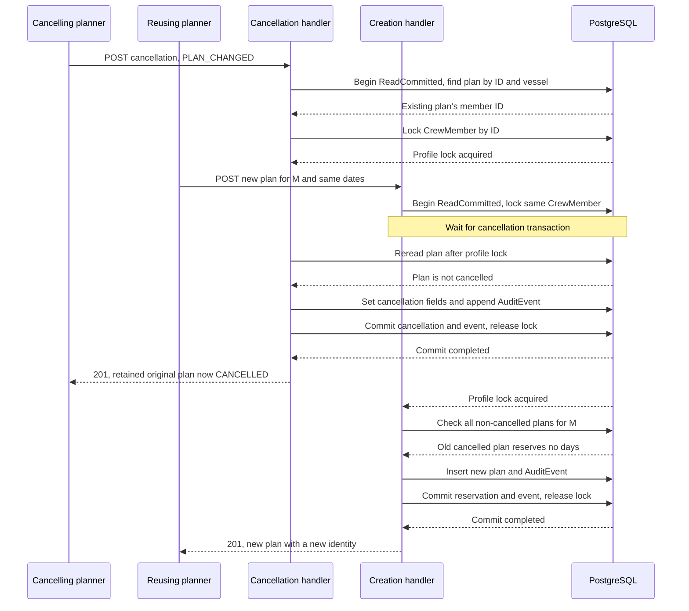

# CrewAssignment: periods, cancellation and qualification coverage

This standalone case implements
[#19](https://github.com/EPraz/keelwatch/issues/19), inspected at repository
`9a83171` on 2026-10-14. It traces the implemented planning protocol using synthetic
examples, current code and existing test evidence. The
[data map](./DOMAIN_MODEL.md), [architecture](./ARCHITECTURE.md) and retrospective
[ADR-0010](./architecture/decisions/0010-crew-profile-lock-and-period-release.md)
explain the wider boundaries. No runtime/schema change or public drill is added.

## The invariant and a concrete cross-vessel race

Two authorized planners select the same CrewMember and concurrently create plans
on different active vessels for 2040-03-01 through 2040-03-15. Both periods include
both endpoints. At most one of these actual overlapping creations can commit:
one returns `201`, the other `409 CREW_ASSIGNMENT_OVERLAP`. Changing the losing
request's vessel or onboard function does not make the person available. Another
CrewMember may use the same dates; this is a per-profile reservation, not vessel
capacity management or evidence of physical presence.

The existing [HTTP/PostgreSQL overlap test](../../apps/api/test/assignment.postgres.integration.spec.ts)
“serializes inclusive overlaps across vessels but permits next-day and other-member
plans” races the two vessels, asserts `[201, 409]`, checks boundary rejection and
accepts a one-day plan on March 16. A plan starting March 15 conflicts with one
ending March 15; March 16 is adjacent and free. The test checks persisted plans
and audit counts after its successful and rejected requests. It does not establish
which planner wins, wait-time bounds, fairness or throughput.

CrewMember is a synthetic profile, not an Access User or DemoAccount. The onboard
roles DEMO_DECK/DEMO_SUPPORT are planning functions, not permissions or official
ranks. Two visitors using Demo Manager share one account; Activity attributes
changes to that account, not the individual visitor. See the
[glossary](../../GLOSSARY.md).

## Request, validation and transactional reservation

The Vessel Workspace uses a [paginated profile picker and form](../../apps/web/src/features/crew/assignment-form.tsx).
Its selected profile persists across picker pages; input validation focuses field
feedback, and a pending request cannot be submitted twice. The
[transport](../../apps/web/src/features/crew/assignment.api.ts) posts crew reference,
onboard role and date-only period to
`/api/v1/vessels/:vesselId/crew-assignments`, with bearer credential and correlation
ID. Vessel context is the route; actor and audit facts are server-owned.

Access authenticates the credential, requires an active User and applies the
[controller's](../../apps/api/src/crew/http/assignment.controller.ts) permissions:
`crew:write` plus `fleet:read` for creation/cancellation, `crew:read` plus `fleet:read`
for history and advisory evaluation. Composition uses those read permissions too.
Manager writes; Auditor reads. Fleet write alone and administration do not grant
Crew write. Frontend visibility is a convenience, not the security boundary.
Demo Manager attempts consume the process-local write budget after authorization,
even when an authorized request later fails validation or overlap checks.

The global [validation pipe](../../apps/api/src/configure-application.ts) rejects
undeclared fields. [Assignment DTOs](../../apps/api/src/crew/http/assignment.dto.ts)
normalize `KW-C-######`, require a closed role and date-shaped strings; the
[service](../../apps/api/src/crew/application/assignment.service.ts) verifies an
existing ACTIVE Vessel, actual calendar dates and start ≤ end. The shared
[calendar parser](../../apps/api/src/crew/domain/qualification.ts) accepts only
`YYYY-MM-DD` in years 0001–9999, rejects year zero/nonexistent days and constructs
UTC midnight values. SQL DATE stores the calendar day without timezone; time-of-day
and local timezone do not turn inclusive planning days into instants.

[Assignment persistence](../../apps/api/src/crew/infrastructure/prisma-assignment.repository.ts)
then explicitly starts a ReadCommitted transaction and:

1. Locks the **CrewMember row**, looked up by normalized crew number, before
   reading reservations. A missing profile yields `404 CREW_MEMBER_NOT_FOUND`.
2. Checks non-cancelled assignments for that member across **all** vessels/functions:
   `existing.startsOn <= proposed.endsOn` and
   `existing.endsOn >= proposed.startsOn`.
3. Rejects an overlap before any insert/event. Otherwise inserts the plan and
   appends CREW_ASSIGNMENT_CREATED using the same transaction client.
4. Commits both facts before returning the created representation. An audit failure
   rolls back the reservation; the lock releases when the transaction ends.

Locking a stable profile handles even the first plan when there is no existing
assignment to lock. All implemented reservation/release writes use that same key.
Unlike Maintenance's editor, Crew explicitly chooses ReadCommitted and does not
use an expectedRevision contract for assignment edits: there is no edit operation.

## Competing creations: one profile, two vessels

The following is one representative ordering after server permission, DTO/date and
Vessel checks. A is arbitrarily shown first; there is no request-arrival priority
guarantee. “Insert plan and AuditEvent” is two writes through the module-owned Audit
writer inside the **same** transaction, not an independent audit commit.

This is application-controlled row serialization under PostgreSQL's
[row-lock behavior](https://www.postgresql.org/docs/17/explicit-locking.html#LOCKING-ROWS)
and [ReadCommitted visibility](https://www.postgresql.org/docs/17/transaction-iso.html#XACT-READ-COMMITTED).
The check after the wait can see the committed winner. Ordinary readers are not
held for the time the browser form is open. Contended writes hold/use a transaction
and connection while waiting; no performance or deadlock-retry guarantee follows.

## Cancellation is final invalidation, not early departure

`POST .../:assignmentId/cancellation` accepts only INCORRECT_RECORD or PLAN_CHANGED.
The UI asks for a reason and explicit confirmation of the selected profile, role
and entire original period. Cancellation is permitted for past, current and future
plans, including plans on archived vessels. It preserves the assignment ID, member,
vessel, function and start/end dates, and stores first cancellation timestamp,
actor and reason. It does not truncate the dates, delete the record, confirm an
early departure or offer reactivation. A replacement is a new validated plan.

The service checks Vessel existence without requiring ACTIVE for cancellation.
Inside a ReadCommitted transaction the repository first resolves the assignment
by ID **and vessel ID** to obtain its member, then locks that member's profile by
ID and rereads the assignment. Creation/cancellation cannot disagree about the
reservation while following this protocol. Wrong-vessel or missing plans yield
`404`, not a mutation to another vessel's record.

If not yet cancelled, it sets all cancellation fields and appends
CREW_ASSIGNMENT_CANCELLED in the same transaction. On a same-reason repeat it
returns the stored cancellation without updating the first actor/time/reason or
adding an event. A different reason returns
`409 CREW_ASSIGNMENT_ALREADY_CANCELLED`, with the first cancellation unchanged.
Both first and same-reason successful calls currently return **201**; do not infer
a new cancellation event from that HTTP status alone. Each request still needs
authorization and can consume the demo write budget even when the business result
is unchanged. The returned derived `asOf` can change on a later day; idempotency
here concerns persistent cancellation facts, not frozen response bytes.

## Cancellation and reuse share one serialization point

This sequence shows cancellation acquiring the profile first while another request
tries to reserve the whole old period. The initial scoped lookup is inside the
cancellation transaction; both requests have passed their pre-transaction checks.

If creation acquires the lock first, the still-reserved period produces `409`;
cancellation may subsequently commit. A **fresh explicit** creation can then pass.
Neither request must win in a particular order. If cancellation's audit fails,
the cancellation rolls back and the old reservation continues to block reuse.
The [cancel/create race test](../../apps/api/test/assignment-cancellation.postgres.integration.spec.ts)
accepts either `201` or `409` for competing creation, checks a fresh request after
conflict, and verifies exactly one remaining non-cancelled reservation and one
cancellation event. Concurrent same-reason retries likewise produce only one
persistent cancellation fact.

## What the database enforces, and what it does not

The [assignment migration](../../apps/api/prisma/migrations/20261008000000_crew_assignments/migration.sql)
enforces UUID identity, member/vessel/creating-User FKs, required dates, closed
function enum and start ≤ end. Its profile/period index supports overlap lookup;
the vessel/creation-time/ID index supports newest-first history. Neither is unique
over periods. The [cancellation migration](../../apps/api/prisma/migrations/20261008010000_crew_assignment_cancellation/migration.sql)
enforces calendar range, closed reason enum, nullable cancelling-User FK and the
all-absent/all-present cancellation metadata check.

**There is no exclusion constraint enforcing non-overlap.** The invariant is
protected by the application transaction/lock/check/write protocol. External SQL
or a future write path bypassing it could insert overlapping non-cancelled plans,
change dates, reactivate a cancelled row or omit audit. The SQL checks are real
integrity protections, but do not impose cancellation finality, active Vessel,
account permissions or write-and-event completeness. See
[atomicity/constraint evidence](../../apps/api/test/assignment-atomicity.postgres.integration.spec.ts).
No extra constraint, extension or new write path is introduced by this case.

History includes cancelled plans with original dates and reason/timestamp in
twenty-row pages, descending creation time and ID. The
[view](../../apps/api/src/crew/domain/assignment.ts) derives SCHEDULED before the
start, CURRENT on every inclusive day, ENDED after the end, with CANCELLED taking
precedence. It includes UTC `asOf`; CURRENT means current **planning**, not actual
boarding. Actor IDs are persisted but not added to this assignment response;
Vessel Activity reads the account actor from Audit. Event entityType is VESSEL,
with assignment ID, synthetic crew number, role, dates and closed reason in
allowlisted metadata; names, tokens and arbitrary request payloads are excluded.

## User-visible recovery and confirmed success

An overlap error keeps the chosen profile, role and dates in
[useAssignmentForm](../../apps/web/src/features/crew/use-assignment-form.ts). It shows
safe field feedback and correlation so the planner can choose non-overlapping
dates and submit explicitly. It does not automatically cancel another plan,
merge inputs, select a free period or retry the creation. A lost response is
uncertain: the generic network-failure message asks the user to check history
before retrying. Unlike the Maintenance review flow, Crew does not impose a
read-and-review gate before another explicit creation attempt. It does not offer
an exactly-once creation key.

[AssignmentCancellation](../../apps/web/src/features/crew/assignment-cancellation.tsx)
retains reason/confirmation after an error and disables duplicate pending requests.
For a generic network failure it advises checking history; repeating the same
reason is safe for persistent cancellation facts, subject to current authorization
and budget. It never repeats the request automatically. Different-reason errors
cannot edit the saved cancellation. Requests are aborted on leaving the form.

After an acknowledged write, [VesselAssignments](../../apps/web/src/features/crew/vessel-assignments.tsx)
announces success, resets history to page one and refreshes history, composition
and Activity. A later read failure preserves that confirmation and offers read
recovery rather than another mutation. Creation resets the form/profile only after
acknowledged success. Draft retention refers to expected errors in the mounted
form, not persistence across logout, reload, route changes or history-driven
unmounting. Auditor sees the same shared plans without creation/cancellation controls.

## Qualification intervals and full-period evaluation

CrewQualification is dated demo evidence attached to CrewMember, not a User grant.
The two kinds DEMO_SAFETY/DEMO_DECK are synthetic; renewals create new references,
retaining prior intervals. Individual status is derived at today's server UTC day
as NOT_YET_VALID/EXPIRED/EXPIRING_SOON (0–30 days)/VALID. That status cannot answer
whether an entire future or past assignment period has coverage.

[Requirement evaluation](../../apps/api/src/crew/domain/requirement-evaluation.ts)
sorts and unions overlapping or day-adjacent intervals per required kind. Support
requires Safety; Deck requires Safety and Deck. It considers all relevant registered
intervals, not just the first qualification history page, and evaluates every
inclusive plan day. INCOMPLETE takes precedence over WARNING over COVERED. Missing
records yield NO_RECORDS; a gap yields its first missing continuous interval.
Full coverage is WARNING if its continuous end is within 0–30 days **after the
plan's end**, otherwise COVERED.

For a Support plan 2040-01-01 through January 31, evidence ending January 15 leaves
a January 16–31 gap. A renewal beginning January 16 through March 2 joins without
a missing day; the effective coverage end is March 2 and the margin exceeds thirty
days in leap year 2040. Starting the renewal January 17 instead would leave January
16 uncovered. The existing
[evaluation test](../../apps/api/test/requirement-evaluation.postgres.integration.spec.ts)
checks consecutive renewals beyond page one and that effective margin.

Evaluation is an authorized **GET**, creates no plan/approval/audit event, and is
advisory. A profile with no qualifications can still be planned. The
[preview](../../apps/web/src/features/crew/use-requirement-preview.ts) owns a separate
read keyed by exact draft/context; changing inputs invalidates/aborts it. Pending
or failed evaluation does not block a valid creation. It records `consultedAt`,
not a persisted fitness verdict or immutable historical approval.

## Composition selects a day but evaluates the whole plan

[CompositionService](../../apps/api/src/crew/application/composition.service.ts)
selects one vessel's non-cancelled plans containing the requested calendar date,
optionally by onboard role. An omitted date defaults to server UTC today. Both
boundary dates count; cancellation removes the entire plan from composition for
**every** selected day, including dates before cancellation, while retaining it in
assignment history. This is current planning data for a selected date, not an
immutable reconstruction of who physically boarded.

Each composition row evaluates qualification coverage for that assignment's
**whole** original period, using currently registered evidence. Thus on January 1
the plan above can show INCOMPLETE because of its January 16–31 gap. The existing
[composition boundary test](../../apps/api/test/composition.postgres.integration.spec.ts)
asserts that result at both plan endpoints, with no row on the preceding/following
day. Newly recorded renewals can change the answer without a read-side mutation.

Composition's assignment page/count uses RepeatableRead and twenty-row paging;
qualification intervals are read afterwards in another query. The whole assembled
response is not one transaction snapshot. It includes date, role, consultedAt and
reasoned results. Server permissions protect the reads; neither UI labels nor
coverage outcomes certify boarding, legal/medical fitness or staffing compliance.

## Directed evidence and interpretation limits

| Existing source/test reading                                                                                                                                                                        | Observable claim to inspect                                                                                                                                              |
| --------------------------------------------------------------------------------------------------------------------------------------------------------------------------------------------------- | ------------------------------------------------------------------------------------------------------------------------------------------------------------------------ |
| [Assignment HTTP/PostgreSQL](../../apps/api/test/assignment.postgres.integration.spec.ts)                                                                                                           | Cross-vessel overlap, inclusive boundaries, another member and next-day acceptance, denied writes, calendar extremes/UTC, stable twenty-row history.                     |
| [Cancellation HTTP/PostgreSQL](../../apps/api/test/assignment-cancellation.postgres.integration.spec.ts)                                                                                            | Preserved original dates, freed-period reuse, same-reason concurrent retries, different-reason conflict, cancel/create race and archived/past/current/future correction. |
| [Atomicity and SQL checks](../../apps/api/test/assignment-atomicity.postgres.integration.spec.ts)                                                                                                   | Failed audit leaves no new reservation; failed cancellation preserves the old reservation; malformed metadata/calendar rows are rejected independently of HTTP.          |
| [Qualification HTTP/PostgreSQL](../../apps/api/test/qualifications.postgres.integration.spec.ts) and [evaluation evidence](../../apps/api/test/requirement-evaluation.postgres.integration.spec.ts) | Retained dated evidence and renewal uniqueness; full-period coverage beyond page one; pure advisory reads and generated contract synchronization.                        |
| [Composition HTTP/PostgreSQL](../../apps/api/test/composition.postgres.integration.spec.ts)                                                                                                         | Vessel/function/date scope, cancelled-plan removal, whole-plan evaluation, current renewals, deterministic pagination and protected contract.                            |
| [Assignment React tests](../../apps/web/src/features/crew/vessel-assignments.test.tsx)                                                                                                              | Retained conflict inputs, pending duplicate prevention, paginated selection/history, cancellation confirmation and confirmed-success/read-only retry behavior.           |
| [Preview](../../apps/web/src/features/crew/requirement-preview.test.tsx) and [composition React tests](../../apps/web/src/features/crew/vessel-composition.test.tsx)                                | Obsolete reads ignored, advisory failure/pending does not block creation, filter/paging state and refresh failure without repeated mutation.                             |

Read persisted HTTP outcomes before React recovery behavior; mocked React responses
are not proof of PostgreSQL locking. #19 reuses historical application/CI evidence,
not a new database race, cloud write or two-tab live experiment. Local documentation
render/link/source checks and executed local gates are recorded in
[progress](../progress.md). Provider loss, higher load and broader recovery guarantees
are not established. The profile lock orders application writes for one member;
independent members still share process, connections and database resources. Fleet
active status is checked before the creation transaction and is not locked by this
profile protocol. Retrospective alternatives and consequences are in ADR-0010;
changed behavior or discovered runtime defects remain separate work.
