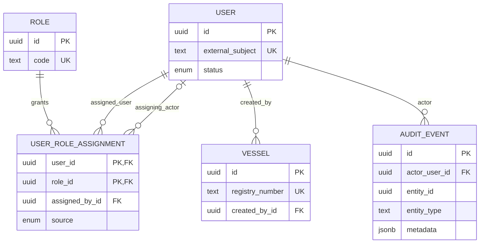
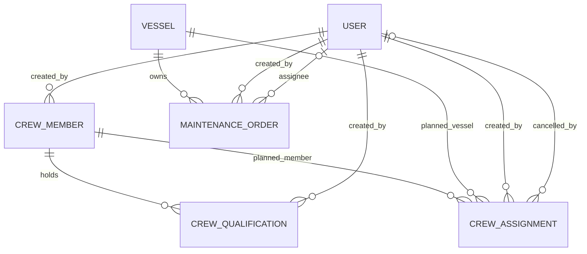
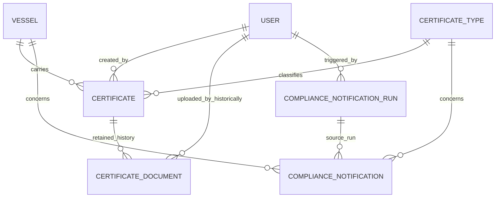

# Current data model and invariants — Keelwatch

Inspected at repository `748310a` on 2026-10-14 for
[#17](https://github.com/EPraz/keelwatch/issues/17). The executable sources are the
[Prisma schema](../../apps/api/prisma/schema.prisma) and
[twelve checked-in SQL migrations](../../apps/api/prisma/migrations).
Existing [progress](../progress.md) records their application and clean CI replay;
this slice inventories that structure without querying the public database or
claiming a new live migration-status check. SQL contains checks and partial indexes
not represented by Prisma's declarative schema alone.

## Ownership and identity

| Business module | Persistent models and derived results                                                                                                                                              |
| --------------- | ---------------------------------------------------------------------------------------------------------------------------------------------------------------------------------- |
| Access          | User, Role, UserRoleAssignment. DemoAccount is a fixed shared User, not an extra table.                                                                                            |
| Fleet           | Vessel.                                                                                                                                                                            |
| Compliance      | CertificateType, Certificate, ComplianceNotification, ComplianceNotificationRun. CertificateDocument is retained inactive attachment history. Compliance status/queue are derived. |
| Crew            | CrewMember, CrewQualification, CrewAssignment. RequirementEvaluation, Composition and temporal statuses are derived, not extra tables.                                             |
| Maintenance     | MaintenanceOrder. MaintenanceAssignee refers to an eligible Access User; history is read from AuditEvent.                                                                          |
| Audit           | AuditEvent; sanitized facts appended by critical writes inside their transaction.                                                                                                  |

The [glossary](../../GLOSSARY.md) distinguishes shared DemoAccount, visitors,
CrewMember, onboard CrewAssignmentRole, MaintenanceAssignee and access roles.
There is no visitor identity, tenant table or User-to-CrewMember relationship.
Business modules own writes; they use exported application boundaries for other
modules' data and Audit's writer for events. All share one PostgreSQL database.

## Foreign-key relationship views

Each line below is an actual foreign key from the child to the named parent.
The views repeat User/Vessel to keep them readable. Optional parents are shown
for nullable assigning/cancelling actors and Maintenance assignees. All foreign
keys use `ON DELETE RESTRICT` and `ON UPDATE CASCADE`.







AuditEvent's only FK is `actor_user_id`. Its `entityType/entityId` and metadata
associate Vessel, Certificate, Crew and Maintenance resources conceptually;
there is no resource FK, cascading resource deletion or enforced polymorphic
relationship. The [Activity reader](../../apps/api/src/audit/infrastructure/prisma-audit-event.reader.ts)
composes Vessel context and permission-scoped Maintenance history from those facts.
Audit is application append-only, not a database-enforced immutable ledger or
event store; arbitrary SQL is outside that guarantee.

## Database constraints and indexes

Every model has a primary-key index: UUID `id`, except UserRoleAssignment's
composite `(user_id, role_id)`. Enum columns enforce their declared closed values;
NOT NULL enforces required fields; FK existence does not enforce user permission,
active status, vessel eligibility or lifecycle. The inventories below list all
additional unique and ordinary indexes in the checked-in migrations. Column
names are SQL names; DESC is explicit where applied.

| Migration / scope                                                                                                  | Database integrity beyond PK/FK/NOT NULL                                                                                                                                                             |
| ------------------------------------------------------------------------------------------------------------------ | ---------------------------------------------------------------------------------------------------------------------------------------------------------------------------------------------------- |
| [Access](../../apps/api/prisma/migrations/20260930000000_init_access/migration.sql)                                | Unique User external_subject and Role code. RoleAssignment source check: SYSTEM_SEED has no assigning actor; ADMIN has one. It does not check that actor's authorization.                            |
| [Fleet and Audit](../../apps/api/prisma/migrations/20261002211320_register_vessel/migration.sql)                   | Unique registry_number; `KW-######` format; trimmed Vessel name length 2–120. No extra Audit index or uniqueness over correlation_id.                                                                |
| [Certificates](../../apps/api/prisma/migrations/20261003000000_certificate_compliance/migration.sql)               | Unique type code and `(vessel_id, certificate_type_id, reference_number)`; type code/name, trimmed reference (1–80)/issuer (2–120) checks; issued_on ≤ expires_on.                                   |
| [Certificate lifecycle](../../apps/api/prisma/migrations/20261004000000_certificate_lifecycle/migration.sql)       | archived_at is null or ≥ created_at. SQL adds updated_at and archived_at; lifecycle/audit behavior stays in application code.                                                                        |
| [Notification jobs](../../apps/api/prisma/migrations/20261004010000_compliance_notification_jobs/migration.sql)    | Unique condition_key WHERE resolved_at IS NULL; unique job_code WHERE status IN (QUEUED, RUNNING). Partial indexes enforce active uniqueness, not worker recovery.                                   |
| [Retired attachments](../../apps/api/prisma/migrations/20261005000000_certificate_document_evidence/migration.sql) | Unique storage_key and certificate_id WHERE status IN (QUARANTINED, AVAILABLE); byte size 1–5242880, SHA-256 format, allowed media type and state/scan/timestamp compatibility checks remain in SQL. |
| [Crew profiles](../../apps/api/prisma/migrations/20261006000000_crew_profiles/migration.sql)                       | Unique crew_number; `KW-C-######`; trimmed display_name length 2–120.                                                                                                                                |
| [Qualifications](../../apps/api/prisma/migrations/20261006010000_crew_qualifications/migration.sql)                | Unique `(crew_member_id, reference_number)`; `KW-Q-######`; valid_from ≤ expires_on. Calendar parsing/range is also checked by the application.                                                      |
| [Assignments](../../apps/api/prisma/migrations/20261008000000_crew_assignments/migration.sql)                      | starts_on ≤ ends_on and closed role enum. No exclusion constraint for overlapping periods.                                                                                                           |
| [Cancellation](../../apps/api/prisma/migrations/20261008010000_crew_assignment_cancellation/migration.sql)         | Cancellation timestamp/actor/reason wholly absent or wholly present; starts_on ≥ 0001-01-01 and ends_on ≤ 9999-12-31.                                                                                |
| [Maintenance](../../apps/api/prisma/migrations/20261009000000_maintenance_orders/migration.sql)                    | Trimmed title length 2–120; revision > 0; optional target_date within 0001–9999. Category, priority and status are closed enums.                                                                     |
| [Maintenance workflow](../../apps/api/prisma/migrations/20261009010000_maintenance_lifecycle_reason/migration.sql) | A non-null reason_code must match BLOCKED or CANCELLED and its closed reasons. SQL permits null even in those states; the application requires a reason when transitioning into them.                |

| Table                                                                    | Applied ordinary indexes (unique indexes are above)                                                                   |
| ------------------------------------------------------------------------ | --------------------------------------------------------------------------------------------------------------------- |
| certificates                                                             | `(vessel_id, certificate_type_id, expires_on DESC)`; `(vessel_id, archived_at, certificate_type_id, expires_on DESC)` |
| compliance_notifications                                                 | `(resolved_at, created_at DESC)`; `(vessel_id, resolved_at)`; `(condition_key, resolved_at)`; `(source_run_id)`       |
| compliance_notification_runs                                             | `(queued_at DESC)`; `(job_code, status)`                                                                              |
| certificate_documents — inactive                                         | `(certificate_id, uploaded_at DESC)`; `(status, uploaded_at)`; `(delete_after)`                                       |
| crew_qualifications                                                      | `(crew_member_id, created_at DESC, id DESC)`                                                                          |
| crew_assignments                                                         | `(crew_member_id, starts_on, ends_on)`; `(vessel_id, created_at DESC, id DESC)`                                       |
| maintenance_orders                                                       | `(vessel_id, created_at DESC, id DESC)`                                                                               |
| users, roles, user_role_assignments, vessels, crew_members, audit_events | No additional ordinary indexes beyond the PK/unique structures above.                                                 |

The certificate indexes are applied, not future candidates. An Audit index on
`(entity_type, entity_id, occurred_at DESC)` or an expiry-only certificate index
remains a candidate, not an adopted structure. No EXPLAIN plan, query timing or
10×/100× capacity is inferred from this inventory. Any future index must be
justified against the actual filters/order, cardinality, plan and write cost.

## Application rules and temporal semantics

User authorization uses externalSubject mapping, active status and server-owned
roles. Email/displayName are presentation attributes, not grants. DemoAccount
subjects map to the two fixed shared Users; the server verifies the expected role
at issuance and protected requests. No permission-administration endpoint is
added here. The role-assignment SQL actor check alone cannot prove administrator
permission. See [Access HTTP evidence](../../apps/api/test/access.integration.spec.ts).

Vessel starts ACTIVE. New certificates, assignments and Maintenance orders require
an active vessel; history remains readable for archived vessels. No public vessel
archive/restore/delete operation is introduced. Certificate renewal creates another
reference; editing retains identity; archiving is logical. Required certificate
types are synthetic demo rules; the seed includes SAFETY_EQUIPMENT. For each
required type, select non-archived evidence issued by `asOf` with the latest expiry:
absent → MISSING, expiry before that UTC day → EXPIRED, 0–30 days remaining →
EXPIRING_SOON, otherwise VALID. Aggregate priority is
MISSING > EXPIRED > EXPIRING_SOON > VALID. These are derived responses, not stored
Certificate statuses. See [Compliance domain](../../apps/api/src/compliance/domain/certificate.ts)
and [HTTP evidence](../../apps/api/test/compliance.integration.spec.ts).

Crew profiles are fleet-global and synthetic; no contact, medical, identity-document
or real fitness data is stored. Qualification kinds DEMO_SAFETY/DEMO_DECK and
assignment roles DEMO_DECK/DEMO_SUPPORT are closed and separate from Access roles.
Qualification validity is derived as NOT_YET_VALID, EXPIRED, EXPIRING_SOON (0–30
days inclusive) or VALID with `asOf` and a reason. Renewal uses another reference;
there is no qualification edit/delete/attachment workflow.

Calendar inputs use date-only values in years 0001–9999 and server UTC evaluation;
SQL DATE stores no timezone. Both period endpoints count. A one-day plan is valid;
2026-10-01–2026-10-15 overlaps a plan starting on the 15th, but not the 16th.
[Assignment persistence](../../apps/api/src/crew/infrastructure/prisma-assignment.repository.ts)
locks CrewMember before checking all non-cancelled plans across vessels, then
creates with audit at ReadCommitted. Cancellation takes the same profile lock,
retains original dates, releases the entire reservation and is terminal. A
same-reason repeat returns the first cancellation without a second event; a
different reason conflicts. SQL bypassing the protocol can violate overlap or
finality; the DB checks are narrower than the application invariant. Assignment
status is SCHEDULED/CURRENT/ENDED by UTC day, with CANCELLED taking precedence.
See [overlap evidence](../../apps/api/test/assignment.postgres.integration.spec.ts),
[cancellation evidence](../../apps/api/test/assignment-cancellation.postgres.integration.spec.ts)
and [atomicity](../../apps/api/test/assignment-atomicity.postgres.integration.spec.ts).

[Requirement evaluation](../../apps/api/src/crew/domain/requirement-evaluation.ts)
unions overlapping or day-adjacent qualification intervals per member/kind for the
entire inclusive plan. Deck requires Safety and Deck; Support requires Safety.
INCOMPLETE reports missing evidence or the first gap; WARNING means full coverage
ends within 30 days after the plan; otherwise COVERED. Today's individual validity
cannot replace full-period coverage. Evaluation is informative and does not block
valid planning, persist an approval or certify boarding/fitness.
[Composition](../../apps/api/src/crew/application/composition.service.ts) selects
non-cancelled plans active on a chosen UTC calendar day, optionally by function,
and evaluates each whole plan using currently registered qualifications. Past-date
composition is not an immutable historical approval. Assignment page/count uses
RepeatableRead; qualification reads follow separately, so the entire composed
response is not a single database snapshot. See
[evaluation](../../apps/api/test/requirement-evaluation.postgres.integration.spec.ts)
and [composition evidence](../../apps/api/test/composition.postgres.integration.spec.ts).

Maintenance starts OPEN with revision 1. Category is PREVENTIVE/CORRECTIVE/INSPECTION,
priority LOW/NORMAL/HIGH. The
[lifecycle](../../apps/api/src/maintenance/domain/maintenance-lifecycle.ts) permits
OPEN → PLANNED → IN_PROGRESS → CLOSED, IN_PROGRESS → BLOCKED → IN_PROGRESS, and
cancellation from non-final states. CLOSED/CANCELLED are terminal. Planning needs
a target date; PLAN/START/RESUME check an active assignee with maintenance:write.
BLOCK reasons are AWAITING_RESOURCES/COORDINATION_REQUIRED; CANCEL reasons are
INCORRECT_RECORD/WORK_NO_LONGER_REQUIRED. Other actions take no reason. These rules
are application-enforced, beyond SQL's reason compatibility check.
[Editing](../../apps/api/src/maintenance/infrastructure/prisma-maintenance-editor.ts)
and [transitions](../../apps/api/src/maintenance/infrastructure/prisma-maintenance-lifecycle.ts)
lock the vessel-scoped order, reject stale expectedRevision (including stale
no-op edits), then update conditionally and increment revision with audit. A current
no-op edit returns unchanged without revision/event. Eligible assignees come from
[Access's directory](../../apps/api/src/access/application/maintenance-assignee.directory.ts).
See [concurrent edits/rollback](../../apps/api/test/maintenance.postgres.integration.spec.ts),
[lifecycle](../../apps/api/test/maintenance-lifecycle.postgres.integration.spec.ts)
and [history evidence](../../apps/api/test/maintenance-history.postgres.integration.spec.ts).

Critical Fleet/Certificate/Crew/Maintenance writes and their sanitized AuditEvent
share a transaction. Rejected writes are not successful domain history; logs may
record their safe response/correlation. Audit persistence failure rolls back the
mutation. Non-idempotent creation is not automatically retried by the UI.

ComplianceNotification represents a derived condition, not email/SMS delivery.
conditionKey combines vessel, type, status and selected evidence. Reconciliation
retains stable conditions, refreshes their reason/asOf, creates new ones and resolves
absent ones. Completion and reconciliation share a transaction. The process-local
runner and partial unique constraints do not recover interrupted QUEUED/RUNNING
rows automatically after restart. See
[notification persistence](../../apps/api/src/compliance/infrastructure/prisma-notification.repository.ts)
and [existing reconciliation evidence](../../apps/api/test/compliance.postgres.integration.spec.ts).

CertificateDocument's table, migration and historical events remain under
[ADR-0007](./architecture/decisions/0007-disable-file-attachments-in-portfolio-demo.md).
The application no longer reads, writes, serves, scans or cleans attachment rows
or bytes. Historical retention timestamps do not promise current deletion.
[Disabled-route tests](../../apps/api/test/file-attachments-disabled.integration.spec.ts)
verify the removed upload/download/cleanup paths.

## Bounded illustrative queries

These examples use positional parameters for synthetic UUIDs/dates. They are
read-only illustrations for a disposable local environment, not commands run
against Neon, complete endpoint queries or evidence of a measured plan. Each
returns at most 20 rows. No credentials or real identifiers are required.

```sql
-- Per-profile overlap predicate; the write protocol also locks CrewMember.
SELECT id, vessel_id, starts_on, ends_on
FROM crew_assignments
WHERE crew_member_id = $1::uuid AND cancelled_at IS NULL
  AND starts_on <= $3::date AND ends_on >= $2::date
ORDER BY starts_on, ends_on, id
LIMIT 20;
```

The profile/period index supports relevant columns, but does not enforce overlap
absence and may still require filtering/sorting. A SELECT alone cannot reserve a
period safely; use the existing transactional application path for writes.

```sql
-- Vessel order history; the applied index matches this ordering.
SELECT id, title, status, revision
FROM maintenance_orders
WHERE vessel_id = $1::uuid
ORDER BY created_at DESC, id DESC
LIMIT 5;
```

Maintenance uses five-row pages, unlike Crew's twenty-row pages. Its optional
status/priority filters are not extra indexed columns in this structure.

```sql
-- Eligible certificate evidence for one type and UTC day.
SELECT id, reference_number, expires_on
FROM certificates
WHERE vessel_id = $1::uuid AND certificate_type_id = $2::uuid
  AND archived_at IS NULL AND issued_on <= $3::date
ORDER BY expires_on DESC
LIMIT 20;
```

The lifecycle index starts with vessel/archive/type and descending expiry;
issued_on remains another predicate. The domain's actual evidence selection and
aggregate rules live in Compliance, not in a claim that this illustrative query
is an optimized replacement.

## Synthetic provisioning and remaining limits

The base seed provisions synthetic access/catalog records, including two fixed
DemoAccounts only when enabled. The explicit operational
[demo seed](./DEMO_DATASET.md) adds 33 baseline records and audit atomically,
preserves visitor changes on rerun and does not run on deploy/startup. The shared
dataset has no visitor isolation or automatic reset; dates stay anchored to first
provisioning. Historical QA records are not a requirement to copy into the cloud.

Multi-tenancy, physical deletion/retention policy, visitor identity, vessel
archiving workflows, automatic job recovery and attachments are outside the
current capabilities. The [architecture](./ARCHITECTURE.md) and
[decision index](./architecture/decisions/README.md) preserve which boundaries
are accepted, historical or still unimplemented. The [evolution analysis](./EVOLUTION.md)
separates illustrative row growth from concurrent requests; its candidates are
not new applied indexes or database guarantees. The
[package verification](./EVIDENCE_VERIFICATION.md) records the integrated checks.
The [Maintenance case](./MAINTENANCE_CASE.md) implements #18 with a retrospective
[concurrency decision](./architecture/decisions/0009-maintenance-revisions-and-row-locks.md).
The [Crew case](./CREW_CASE.md) implements #19, with
[profile-lock/cancellation decisions](./architecture/decisions/0010-crew-profile-lock-and-period-release.md)
recorded retrospectively without changing the guarantees above.
The supporting [Access case](./ACCESS_CASE.md) implements #20 with the current
User/DemoAccount, permission, session and shared-budget boundaries.
The separate [audit rollback](./AUDIT_ROLLBACK_CASE.md) and
[reconciliation/restart](./RECONCILIATION_CASE.md) cases implement #21, including
the distinction between atomic completion and process-local scheduling. Its
[retrospective runner decision](./architecture/decisions/0011-local-notification-runner-and-atomic-reconciliation.md)
preserves the existing guarantees and explicit recovery limits.
