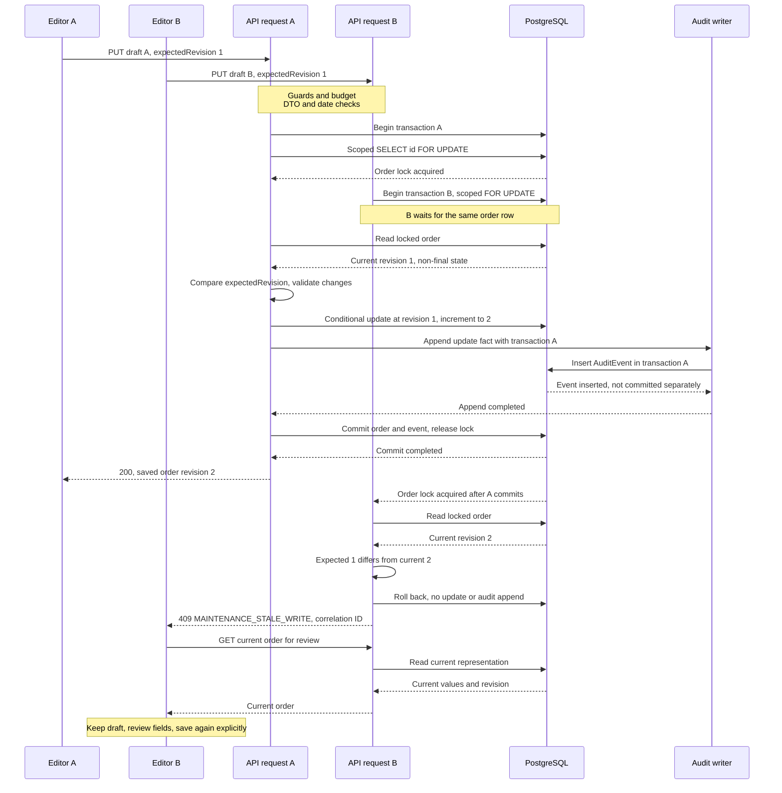
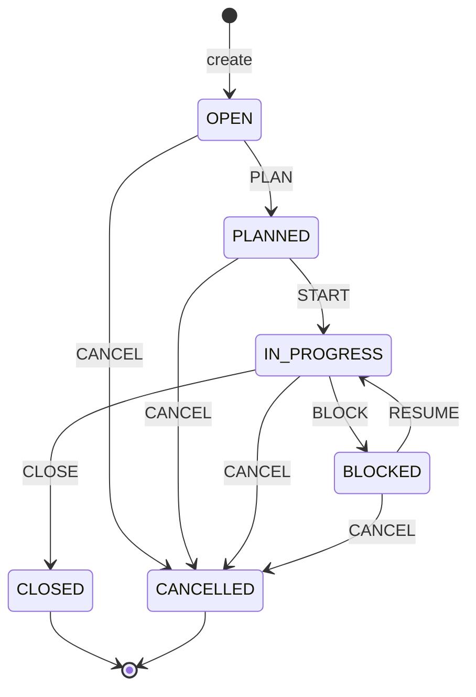

# MaintenanceOrder: competing edits, lifecycle and recovery

This standalone case implements
[#18](https://github.com/EPraz/keelwatch/issues/18), inspected at repository
`63fe9a8` on 2026-10-14. It explains existing behavior using synthetic scenarios
and source/test evidence. No runtime, schema, public write or fault drill is added.
The [system map](./ARCHITECTURE.md), [data guide](./DOMAIN_MODEL.md) and
[ADR-0009](./architecture/decisions/0009-maintenance-revisions-and-row-locks.md)
provide the wider boundaries and the retrospective decision record.

## The problem: two valid drafts cannot silently overwrite each other

Two authorized editors open the same synthetic order, “Inspect cooling pump,”
at revision 1. Editor A changes its title to “Inspect impeller”; Editor B changes
it to “Inspect coupling.” Both send the revision they read. Either request may
win. Once one actual change commits as revision 2, the other request must return
`409 MAINTENANCE_STALE_WRITE`, leaving the winner and its single update event
intact. The rejected editor's draft remains visible for deliberate review.

This is the exact shape of the existing
[HTTP/PostgreSQL edit race](../../apps/api/test/maintenance.postgres.integration.spec.ts),
whose test “allows only one concurrent edit from the same revision and preserves
the winner” checks `[200, 409]`, the persisted winning title/revision and exactly
one creation event plus one update event. It does not establish lock-wait latency,
fairness, load capacity or which editor wins.

Two browser tabs can belong to the same shared Demo Manager. They are two editors,
not two distinct User identities: Activity identifies the DemoAccount, not the
visitors. Normal Auth0 identities use the same operational protocol and server
permissions. No assignee-only editing rule exists.

## The end-to-end write boundary

1. The [edit form](../../apps/web/src/features/maintenance/maintenance-form.tsx)
   validates the draft for immediate feedback and disables pending submission.
   [useMaintenanceForm](../../apps/web/src/features/maintenance/use-maintenance-form.ts)
   owns the draft, the last reviewed baseline and its revision; it does not treat
   an unsaved field change as a new server revision.
2. The [transport](../../apps/web/src/features/maintenance/maintenance.api.ts)
   sends `PUT /api/v1/vessels/:vesselId/maintenance-orders/:orderId` with JSON,
   bearer credential, `expectedRevision` and a generated correlation ID. Lifecycle
   uses `POST .../:orderId/transitions`, also with an expected revision. Field edits
   return `200`; successful transitions return `201`.
3. Access authenticates the credential and active User, resolves permissions and
   enforces the [controller's](../../apps/api/src/maintenance/http/maintenance.controller.ts)
   `maintenance:read`, `maintenance:write` and `fleet:read` requirements before the
   handler. Auditor lacks write permission; Platform Administrator and Compliance
   Officer do not implicitly gain Maintenance. For Demo Manager, the shared
   process-local write budget is checked after permission and before validation;
   an authorized stale/invalid attempt consumes that budget even though it does
   not produce successful Activity.
4. The global [validation boundary](../../apps/api/src/configure-application.ts)
   rejects undeclared DTO fields. The [DTOs](../../apps/api/src/maintenance/http/maintenance.dto.ts)
   validate values and require integer `expectedRevision` from 1 to 2147483646.
   Numeric strings, missing/null/fractional/out-of-range revisions are invalid.
   The [service](../../apps/api/src/maintenance/application/maintenance.service.ts)
   checks Vessel existence and parses the optional calendar date before editing.
5. The [editor](../../apps/api/src/maintenance/infrastructure/prisma-maintenance-editor.ts)
   begins a Prisma transaction, locks the row by **order ID and vessel ID**, reads
   it, checks expected revision and finality, and computes actual field changes.
   A changed non-null assignee is checked through Access's directory. A missing
   vessel/order relationship returns `404`, rather than editing another vessel's
   order. The record's Vessel and identity are not editable fields.
6. An actual change updates with `where: { id: orderId, revision: expectedRevision }`
   and increments revision by one. The Audit writer receives the same transaction
   client. Mutation and event commit together; the representation is returned only
   after that transaction completes. An error rolls the transaction back.

The lifecycle persistence collaborator takes the same scoped lock before checking
revision, transition rules and current planning eligibility. This is a revision
precondition combined with pessimistic row serialization; it is neither exclusively
optimistic nor lock-free. The conditional update remains an explicit mutation
precondition even though the lock already orders these application writes.

## A representative competing-edit sequence

Both requests have passed guards, DTO validation, date parsing and Vessel existence
before their mutation transactions below. A is shown acquiring the lock first;
that order is illustrative. Audit is a module-owned writer using the caller's
transaction, not another service or independent commit.

The lock lasts for the transaction, not for the time a form is open. Ordinary reads
can still observe committed data; another writer to the same row waits. See
[PostgreSQL 17 row-lock semantics](https://www.postgresql.org/docs/17/explicit-locking.html#LOCKING-ROWS).
These writes do **not** explicitly set an isolation level. The waiting/read-current
interleaving describes the existing tested environment and PostgreSQL's usual
[ReadCommitted default](https://www.postgresql.org/docs/17/transaction-iso.html#XACT-READ-COMMITTED);
it does not verify the live provider's setting. Changing to RepeatableRead or
Serializable can instead yield serialization failures and requires reconsidering
the error/retry behavior. No generic deadlock or serialization-retry loop is added.

If A's audit append fails before commit, A rolls back its fields and revision. B
can then see revision 1 and succeed; “one winner” is not a promise that a failed
first attempt consumes a revision. Network response delivery is also separate
from commit: B may proceed after A commits while A's response is still in transit.

## Review the conflict without losing intent

On a stale-write conflict, the form keeps its draft, disables save and automatically
**reads**, rather than rewrites, the current record. The review shows old baseline,
current values and draft for editable fields changed since that baseline. “Use
current” replaces an individually chosen draft field; leaving it alone retains the
draft value. “Continue with reviewed values” adopts the current revision but sends
no write. A separate save submits the reviewed draft with that new revision.
Another editor can change the order again between review and save: another conflict
returns to the same recovery flow. There is no automatic merge or reservation while
reviewing. Fields sent with a retained draft can deliberately replace current values
only after that explicit review/save.

If the recovery GET fails, the retained draft stays visible and “Retry maintenance
read” retries only that GET. A current CLOSED/CANCELLED order cannot be accepted for
another edit; the draft can remain visible without permission to save it. The
[existing form tests](../../apps/web/src/features/maintenance/maintenance-form.test.tsx)
exercise failed recovery, final-state locking and repeated conflict review with
expected revisions 1, 2 and 3. They simulate HTTP responses in React; they do not
prove database locking.

The [lifecycle hook](../../apps/web/src/features/maintenance/use-maintenance-lifecycle.ts)
similarly retains action/reason, reads the latest state, and requires explicit
review before another action. If another saved field edit refreshes the detail,
the action must be rechecked against that revision/state. An action invalidated
by the latest state is no longer available. Final state leaves the intent visible
with no further permitted action. See the
[lifecycle review](../../apps/web/src/features/maintenance/maintenance-transition-review.tsx)
and [React tests](../../apps/web/src/features/maintenance/maintenance-lifecycle.test.tsx).

A timeout/network failure or `5xx` makes the client uncertain about a write, not
certain that it failed before commit. Both hooks require current-state review;
neither automatically repeats the mutation. After acknowledged success,
[MaintenanceDetail](../../apps/web/src/features/maintenance/maintenance-detail-page.tsx)
retains the confirmed result and success Toast while refreshing detail/history.
A failed refresh has its own read recovery; “Retry history read” does not repeat
the edit or transition. Session/route changes abort requests and ignore late
responses. Draft retention applies inside this workspace, not durable storage
across reload, logout or a changed role.

## Ownership, constraints and lifecycle

Maintenance owns MaintenanceOrder. Fleet supplies vessel context; Access owns
eligible User lookup; Audit owns sanitized facts. A MaintenanceAssignee is an
active User with `maintenance:write`, never a CrewMember. Any permitted writer can
manage an order; assignee selection does not grant permissions.

The [order migration](../../apps/api/prisma/migrations/20261009000000_maintenance_orders/migration.sql)
enforces UUID PK/FKs to Vessel, creating User and optional assignee; deletion is
RESTRICT. It checks trimmed title length 2–120, positive revision and nullable
target_date within years 0001–9999, with closed category/priority/status enums.
Category is PREVENTIVE/CORRECTIVE/INSPECTION; priority LOW/NORMAL/HIGH. Target dates
are actual `YYYY-MM-DD` calendar dates stored as SQL DATE and returned without a
timezone/time component; invalid dates/year zero are rejected. Past dates are
allowed, not a reminder schedule. Creation produces OPEN at revision 1.

The ordinary `(vessel_id, created_at DESC, id DESC)` index supports the vessel list's
stable ordering; list pages are five rows. Eligibility selector pages are twenty.
These are actual current sizes, rather than the original spec's twenty-row order
list/history proposal. There is no SQL constraint enforcing revision increments,
the state graph, assignee permission or critical-write audit completeness: those
belong to application writes. SQL bypassing the protocol is outside their guarantee.

| Action         | Additional application rule                                                                |
| -------------- | ------------------------------------------------------------------------------------------ |
| PLAN           | OPEN only; saved target date and currently eligible assignee required.                     |
| START / RESUME | PLANNED / BLOCKED respectively; currently eligible assignee required.                      |
| BLOCK          | IN_PROGRESS; AWAITING_RESOURCES or COORDINATION_REQUIRED required.                         |
| CLOSE          | IN_PROGRESS; terminal, no reason; later-ineligible assignee does not prevent finalization. |
| CANCEL         | Any non-final state; INCORRECT_RECORD or WORK_NO_LONGER_REQUIRED required; terminal.       |

Other actions accept no reason. Transitions use saved details, not unsaved fields.
[Lifecycle rules](../../apps/api/src/maintenance/domain/maintenance-lifecycle.ts)
enforce these edges. The [reason migration](../../apps/api/prisma/migrations/20261009010000_maintenance_lifecycle_reason/migration.sql)
only checks that a **non-null** reason matches BLOCKED/CANCELLED and its allowed
codes; SQL still permits null there, while the transition API requires the reason.
There is no reopen, public delete or periodic-maintenance/notification workflow.

Eligibility is checked at creation when an assignee is supplied, when changing to
a non-null assignee, and at PLAN/START/RESUME. Keeping an already-selected User on
an unrelated field edit does not recheck eligibility; deactivation does not erase
that reference or history. BLOCK/CLOSE/CANCEL permit correction/finalization after
ineligibility. Existing archived-vessel orders remain readable/manageable under
their state/permission rules; new orders require ACTIVE Vessel.

## Revisions, no-op and atomic successful history

Revision comparison occurs before finality and before no-op detection. A matching,
non-final edit with identical normalized values returns `200` without incrementing
revision or appending an event. A stale request remains `409` even if its payload
matches the current fields. CLOSED/CANCELLED rejects edits even when unchanged;
stale final-order requests can report stale-write first. Repeated transitions are
not idempotent retry commands: the previous revision/state will be rejected.

Creation, actual edits and transitions append MAINTENANCE_ORDER_CREATED,
MAINTENANCE_ORDER_UPDATED and MAINTENANCE_ORDER_TRANSITIONED respectively in the
same transaction as the order/revision change. Events carry actor and correlation
in their own columns. Metadata is allowlisted: vessel, known fields, old/new values,
revision and action/state/reason where applicable. It excludes tokens, arbitrary
payloads and email/subjects.
Invalid, denied, stale and no-op requests do not create a successful history fact.
Safe operational logs/correlation can explain failures; Activity is not a ledger
of every attempted request or an event store reconstructing the order.

[Order history](../../apps/api/src/maintenance/application/maintenance-history.service.ts)
requires `maintenance:read`, `fleet:read`, `activity:read`; it is scoped to the
order and vessel before consulting Audit. Five-event cursor pages use descending
timestamp/ID with validated scoped anchors. The
[decoder](../../apps/api/src/maintenance/application/maintenance-history-values.ts)
exposes known fields/reasons and the Access directory resolves responsible display
names. Final orders and later-inactive users remain explainable. Shared demo actor
names are account attribution, not personal visitor attribution.

## Directed evidence reading and what it demonstrates

| Read this existing evidence                                                                                                                                                                                                  | Check the observable claim                                                                                                                                         |
| ---------------------------------------------------------------------------------------------------------------------------------------------------------------------------------------------------------------------------- | ------------------------------------------------------------------------------------------------------------------------------------------------------------------ |
| [Maintenance HTTP/PostgreSQL](../../apps/api/test/maintenance.postgres.integration.spec.ts) — edit race, no-op/stale no-op, revision validation, cross-vessel denial, eligibility, creation/edit audit failure               | One committed edit from a two-change race; winner retained; no-op has no new revision/event; stale no-op rejected; failure leaves order/revision/events unchanged. |
| [Lifecycle HTTP/PostgreSQL](../../apps/api/test/maintenance-lifecycle.postgres.integration.spec.ts) — every edge, revision/reason validation, edit/transition and transition/transition races, eligibility and audit failure | Allowed/denied graph, one actual race winner with one mutation event, rollback of state/revision and existing archived-vessel management.                          |
| [History HTTP/PostgreSQL](../../apps/api/test/maintenance-history.postgres.integration.spec.ts) — race winner, stable timestamp ties, allowlist and permission cases                                                         | Only committed race history, scoped paging without displacing older entries, readable final records and bounded metadata.                                          |
| [Form React tests](../../apps/web/src/features/maintenance/maintenance-form.test.tsx) — retained draft/repeated conflicts and failed review read                                                                             | Explicit reviewed revision on each retry; read retry does not repeat mutation; final current values lock saving.                                                   |
| [Lifecycle React tests](../../apps/web/src/features/maintenance/maintenance-lifecycle.test.tsx)                                                                                                                              | Retained action/reason, repeated conflicts, obsolete-action removal, pending double-submit prevention and unmount cleanup.                                         |
| [Detail React tests](../../apps/web/src/features/maintenance/maintenance-detail-page.test.tsx)                                                                                                                               | Acknowledged mutation survives refresh failure; history retry is read-only; finalization preserves unsaved intent visibly; Auditor has no editing controls.        |

Read in that order: persisted HTTP outcomes establish consistency; React interaction
tests establish recovery behavior. The [Phase 5 acceptance record](../progress.md#fase-5-aceptada-por-el-propietario-2026-10-11)
and [journey evidence](./DEMO_JOURNEY_QA.md) preserve the owner's public acceptance
and its observation limits. #18 adds no new live two-tab experiment, database race
or provider-failure drill; existing PostgreSQL results remain historical evidence.
The package's local verification is rendering, navigable links, source agreement
and the checks recorded in [progress](../progress.md).

## Consequences and limits

The protocol prevents silent stale overwrite for application-managed edits and
transitions while making the actor's intent reviewable. Its cost is waiting on a
contended row, extra current-value reads and repeated manual review if another
writer wins again. Independent order rows are not intentionally serialized by
this order lock, but still share process, connections and database capacity.
No throughput, wait-time bound, fairness, visitor isolation, real-world work
completion or provider availability is established by these tests.

The row lock protects the order/revision decision; it does not lock the User's
status/role for the whole request or guarantee eligibility cannot change after
lookup. Account-level authorization and transition eligibility are checked at
their implemented lookup points, not globally serialized with administrative SQL.
The [retrospective ADR](./architecture/decisions/0009-maintenance-revisions-and-row-locks.md)
compares last-write-wins, conditional-only updates, lock-only writes and stronger
isolation as design alternatives, without inventing the original implementer's
unrecorded reasoning. Any behavior defect or changed guarantee is separate work.
