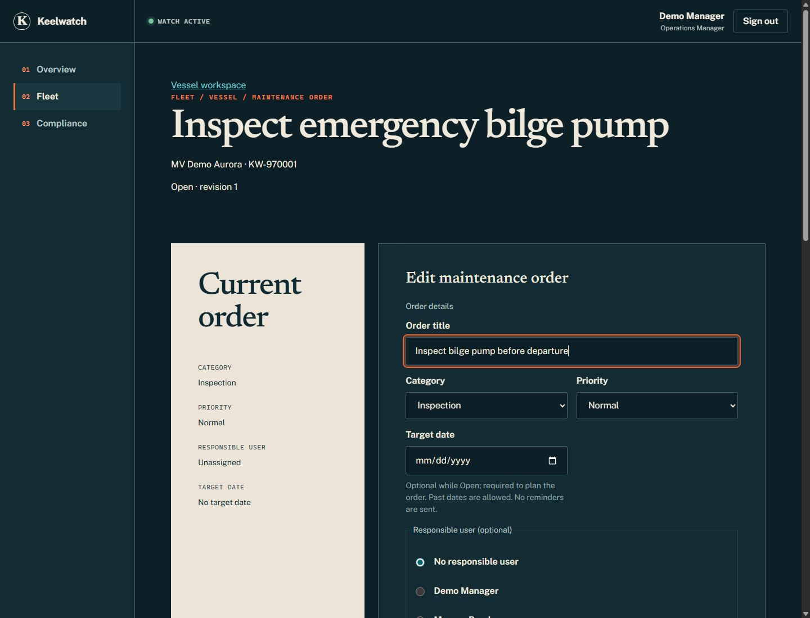
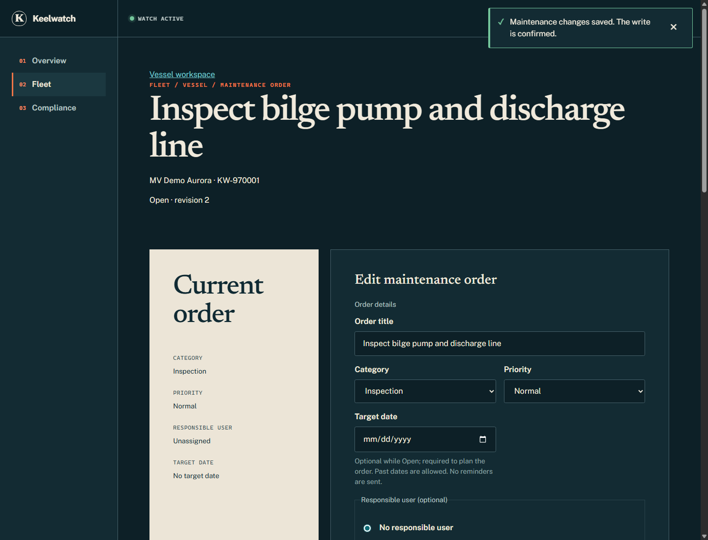
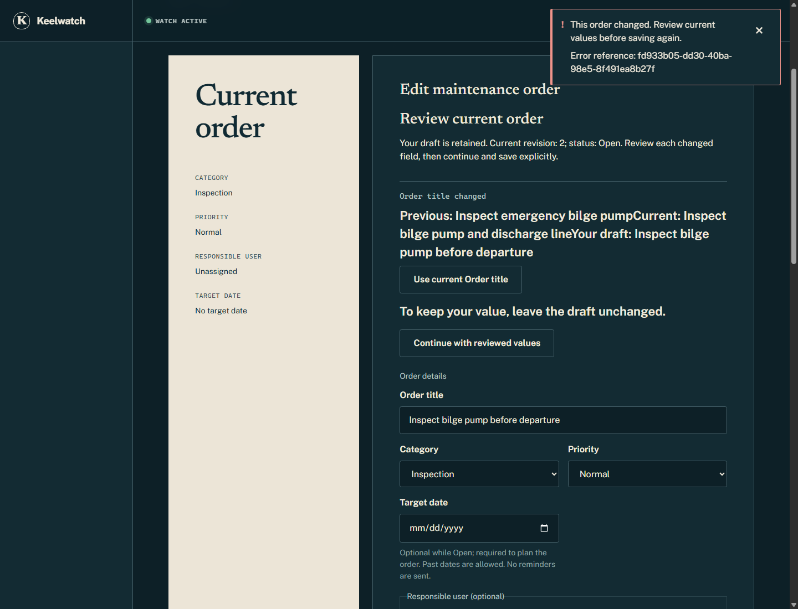
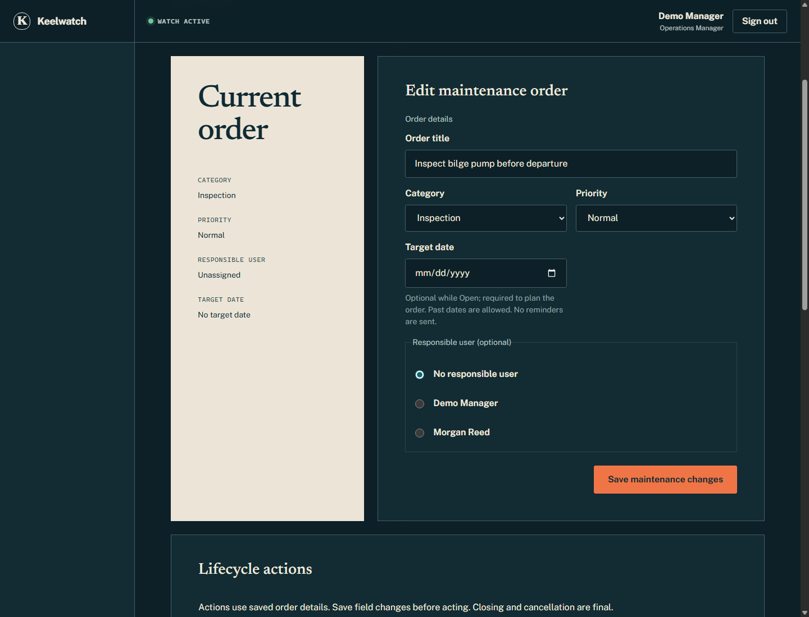
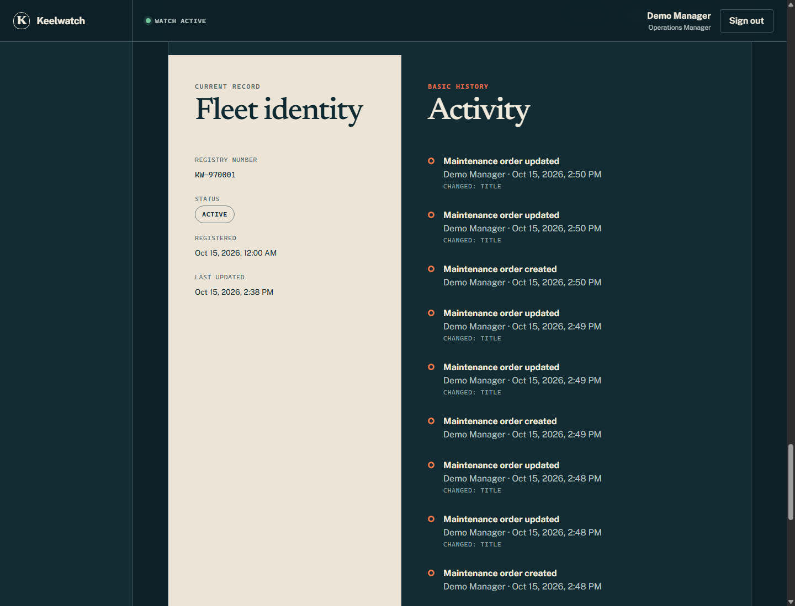
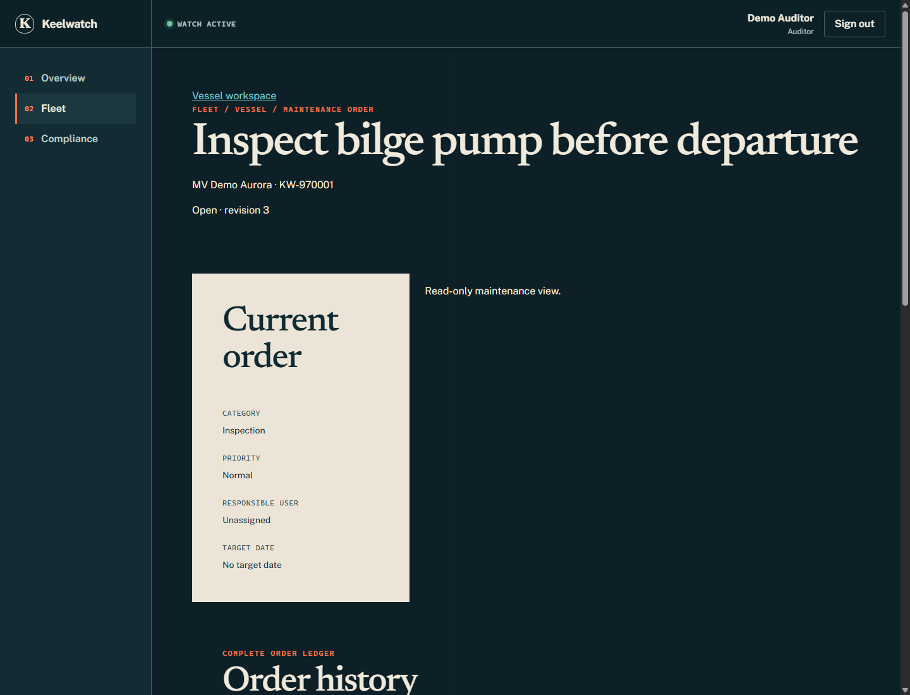

# A maintenance edit that requires a deliberate decision

Two Manager editors open one maintenance order at revision 1. One saves; the
other encounters a stale-write conflict, reviews the newer values and saves
deliberately. An Auditor then reads the same record without editing it.

These six captures come from the **real local React app, NestJS API and an
isolated PostgreSQL schema**, using synthetic accounts and records. They are
not mocked component renders or a fresh check of the public deployment.

[Read the case study](./CASE_STUDY.md) ·
[Inspect the concurrency protocol](./MAINTENANCE_CASE.md) ·
[Try the shared public demo](https://keelwatch-chi.vercel.app/sign-in)

The [silent 2:24 companion video](./media/maintenance/maintenance-story.mp4)
re-runs this local scenario with English captions and an
[accessible transcript](./MAINTENANCE_VIDEO.md). The six original captures below
remain independently useful and retain their own capture provenance.

## 1. Two editors have reviewed the same revision

Both tabs have loaded revision 1 of “Inspect emergency bilge pump” on MV Demo
Aurora (`KW-970001`). The second editor has drafted “Inspect bilge pump before
departure”, while the first editor will save “Inspect bilge pump and discharge
line”. The screenshot shows the second editor's unsaved title beneath the
original record heading.



## 2. The first editor saves revision 2

The first save succeeds. The heading changes, revision becomes 2 and the Toast
confirms the write. The second tab still holds its revision-1 draft.



## 3. The stale save preserves the draft

The second editor's save returns `409 MAINTENANCE_STALE_WRITE`. The form keeps
the draft and loads revision 2 for comparison. The comparison labels the
previous title, the current saved title and the draft. The original inline
layout places these labels close together; their values are also written above.

The order stays at revision 2 and its history is unchanged by this rejected
attempt. To retain their title, the editor leaves the draft unchanged rather
than selecting “Use current Order title”.



## 4. Reviewing does not write

The editor focuses “Continue with reviewed values” and activates it with Enter.
The comparison closes and Save becomes available, with the drafted title intact.
The API still reports revision 2: continuing sends no maintenance write. The
editor must separately choose “Save maintenance changes”.



## 5. Activity records the confirmed changes

The deliberate save succeeds at revision 3. The order ledger contains exactly
three events for this order: creation and two successful title changes. The
vessel's Activity includes those same event IDs; the capture shows its newest
maintenance changes. The rejected save adds no successful event.

Both tabs used **Demo Manager**, a shared DemoAccount. Activity attributes the
changes to that account, not to distinct visitors. The order remains unassigned;
a maintenance responsible user would be a Keelwatch access user, not a CrewMember.



## 6. The Auditor sees the same revision read-only

Demo Auditor reads the final title and revision 3 with no maintenance edit form.
A direct authenticated update attempt also returns `403`; the order revision and
history remain unchanged. Hiding the form supports the experience; server
authorization enforces the boundary.



## Source and verification boundaries

- Captured on 2026-10-15, at 14:50:35 UTC, using application source
  `344a1078012c9f4168df30e1b19fe82bbbf54749`. Application files were unchanged;
  this delivery adds capture tooling, media and documentation.
- Node 24.13.0, Chrome 155.0.8059.79 headless, PostgreSQL **18.1** as reported by
  the connected local server. This is separate from the PostgreSQL 17 CI evidence.
- Six original PNG viewports at 1440 × 1100, approximately 665 KiB combined.
  Open an image to inspect the full resolution. Text descriptions explain the
  entire story without requiring images or video.
- [Machine-readable capture evidence](./media/maintenance/capture-evidence.json)
  records source, date, browser, synthetic references, sizes and observed results.
  It contains no connection strings or session credentials.
- Preparation verified an empty randomly named `kw_capture_…` schema before
  applying all twelve checked-in migrations and the existing synthetic seeds.
  Before operational writes, the API's Manager identity was matched to the
  isolated schema's newly seeded User ID. No responses or product DOM were mocked.
- Counts and SHA-256 fingerprints of all fifteen retained `public` tables,
  including the migration ledger, were compared before and after preparation and
  verification. No retained data was reset, truncated or deleted. Capture retries
  created additional synthetic orders inside the isolated schema; they are retained.
- The capture has no uncaught browser runtime exceptions. After waiting for the
  resize layout to settle, the Auditor view has no document overflow at 320, 375,
  768, 1024 and 1440 px. An earlier immediate read reported 343 px at 320 px;
  settled measurements did not reproduce it. The narrow navigation itself scrolls
  within its own container. This limited inspection is not a complete responsive
  or accessibility certification; the dense inline comparison remains unchanged.
- Existing rendered-form tests cover recovery failures and repeated conflicts;
  PostgreSQL tests cover concurrent winners, rollback and role denial. The visible
  sequence does not induce audit failure or establish lock-wait, capacity or public
  availability guarantees. See [the technical case](./MAINTENANCE_CASE.md) for those
  separate tests and [verification](./EVIDENCE_VERIFICATION.md) for historical CI.

The owner accepted the delivered case, entry, captures and both videos on
2026-10-16 at `8b88f46`. Material content changes require renewed review before
portfolio integration. No portfolio change is included here.

## Reproduce locally

Use the repository's normal prerequisites and install from its lockfile. The root
ignored `.env` must point to an existing **local** PostgreSQL database whose retained
schema is `public`; the database role must be allowed to create a schema. Keep its
credentials private. No new service, database reset or paid tool is required.

From the repository root:

```text
npm run build
node scripts/maintenance-capture-env.mjs prepare
node scripts/maintenance-capture-env.mjs serve
```

Keep `serve` running and use a second terminal:

```text
node scripts/maintenance-capture.mjs
node scripts/maintenance-capture-env.mjs test
node scripts/maintenance-capture-env.mjs verify
```

The private runtime manifest, logs and Chrome profiles stay under ignored
`.scratch/maintenance-capture/`. Never publish that directory. `prepare` creates
a new schema each time and keeps previous schemas; no automatic cleanup runs.
`serve` requires unused ports 3197/5197, verifies the schema and retained data, and
rejects application-source changes since preparation. The real web app uses
`http://127.0.0.1:5197`, proxying to the isolated API on port 3197. The synthetic
local identity adapter is enabled only in development; the demonstrated sign-ins
use the separate signed Demo Manager and Demo Auditor accounts.

On Windows, capture defaults to installed Chrome at
`C:/Program Files/Google/Chrome/Application/chrome.exe`; set `CAPTURE_CHROME` to an
existing Chrome executable elsewhere. No browser download is performed. The script
opens three fresh tabs, drives existing inputs/buttons and saves the six images
and evidence JSON. It checks the observable outcome and does not add a test API.
Capturing again creates another synthetic order and replaces the published media;
review the new images, evidence date and affected text before committing them.

`test` runs the three existing Maintenance PostgreSQL files against this isolated
schema with one worker, then compares the retained-data fingerprint again. Stop
the temporary servers with Ctrl+C after verification. The capture process closes
its own Chrome process; local schema data remains available for inspection.
