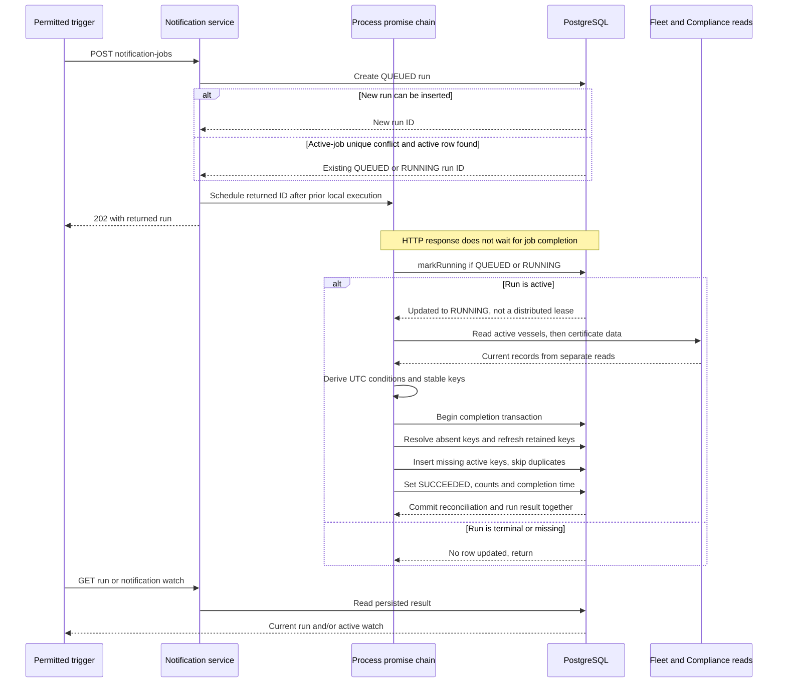

# Compliance reconciliation, idempotency and runner limits

This supporting case implements the job half of
[#21](https://github.com/EPraz/keelwatch/issues/21), inspected at repository
`e24d316` on 2026-10-14. It follows existing notification derivation, runs and UI;
the separate [audit case](./AUDIT_ROLLBACK_CASE.md) covers critical operational
write rollback. These are synthetic demo notifications, not email/SMS delivery.

## The job reconciles derived conditions

Operational certificate records are the evidence. The
[Compliance rule](../../apps/api/src/compliance/domain/certificate.ts) considers
required certificate types and non-archived evidence issued by the selected UTC
day. It selects evidence by expiry, then issue/create time and ID. Missing evidence
is MISSING; past expiry is EXPIRED; 0–30 days remaining is EXPIRING_SOON;
later expiry is VALID. These are original demo rules, not regulatory approval.

The [condition derivation](../../apps/api/src/compliance/domain/notification.ts)
uses active vessels and the current UTC day and emits only the three risk statuses.
The condition key is:

```text
vesselId : certificateTypeId : status : selectedCertificateId-or-none
```

Dates/reason text and the run ID are not part of this key. The same missing
requirement or same evidence/status can remain one active condition across runs,
while reason/asOf refresh. A different selected certificate or status produces a
different key: the old condition resolves and the new one can be created. If no
longer risky, it is absent from the derived set and resolves. Resolution records
resolvedAt rather than deleting history. A resolved key can recur as a new row;
idempotency is scoped to **active** conditions, not one notification forever.

The runner first reads active vessels, then certificate/type data through the
[query helper](../../apps/api/src/compliance/infrastructure/compliance-query.ts),
then computes conditions outside the completion transaction. These steps are not
one immutable snapshot with concurrent certificate/Fleet changes. Later runs can
reconcile newer evidence; this is a periodically requested derived watch, not an
instantaneous rule enforced on every certificate write.

## Trigger, local serialization and atomic completion

The [controller](../../apps/api/src/compliance/http/compliance-notification.controller.ts)
requires current server permissions: `fleet:write` for
`POST /api/v1/compliance/notification-jobs`, `fleet:read` for
`GET /api/v1/compliance/notification-jobs/:jobRunId` and
`GET /api/v1/compliance/notifications`. The POST returns `202` with a run, not proof
of completion. Auditor cannot trigger it. Demo Manager's write-attempt budget
applies before the handler; [Access](./ACCESS_CASE.md) explains denied/limited calls.

The [service](../../apps/api/src/compliance/application/notification-job.service.ts)
always schedules the returned run ID, whether enqueue created it or reused an
active run. Scheduled calls use one promise chain per service instance. Each call
first tries markRunning; a terminal row is ignored. The current update accepts
either QUEUED **or already RUNNING**, updates startedAt and clears failureCode.
It is not an exclusive distributed claim. The internal runNow helper calls
execute directly, bypassing the chain; it is not another HTTP endpoint.



The DB response represents the service's repository result, including handling
the uniqueness exception and reading the existing active row. The repository can
still throw if that lookup finds no active row; there is no general retry loop.
Scheduling and response delivery can interleave, so a returned QUEUED view need not
be the current state by the time the browser reads it. The sequence shows the
successful execution path; interruption/failure boundaries are described below.

In [notification persistence](../../apps/api/src/compliance/infrastructure/prisma-notification.repository.ts),
complete wraps these steps in one Prisma transaction:

1. Resolve all currently active notifications whose keys are absent from the new
   set; an empty set resolves all. This is a fleet-wide reconciliation, not just
   the latest edited vessel.
2. Find retained active keys and update their reason/asOf. Their ID, createdAt and
   sourceRunId remain from the original creation.
3. Insert new keys with this sourceRunId, using createMany/skipDuplicates.
4. Set the run SUCCEEDED with completedAt, createdCount, skippedCount and
   resolvedCount, clearing failureCode.

skippedCount is derived-condition count minus inserted count, not the number of
all input certificates or HTTP attempts. “Unchanged” in UI feedback includes
retained keys whose reason/asOf was refreshed. Watch returns up to 20 active items,
their total and the latest run, not an unbounded history export. Its several reads
do not declare an isolation override or prove a global concurrent snapshot.

## Two database constraints, two different responsibilities

The [applied SQL migration](../../apps/api/prisma/migrations/20261004010000_compliance_notification_jobs/migration.sql)
defines partial unique indexes that the Prisma schema alone does not express:

| Predicate and key                          | Guarantee and boundary                                                                                                                                       |
| ------------------------------------------ | ------------------------------------------------------------------------------------------------------------------------------------------------------------ |
| condition_key WHERE resolved_at IS NULL    | At most one unresolved row for an exact condition key. Resolved rows can coexist; this is not external-message deduplication or perpetual suppression.       |
| job_code WHERE status IN (QUEUED, RUNNING) | At most one active row per job code (currently EXPIRY_NOTIFICATIONS). It coalesces trigger records; it does not grant one worker exclusive execution rights. |

The [PostgreSQL 17 partial-index explanation](https://www.postgresql.org/docs/17/indexes-partial.html)
explains uniqueness over a predicate-defined subset. A database constraint survives
process restart; the promise chain does not. Both facts matter, but neither proves
end-to-end exactly-once execution. Another process can receive the same RUNNING ID
and pass markRunning too. There is no owner, lease, heartbeat, fencing token or
compare-owner completion. Competing executors' complete/fail calls are not guarded
by worker ownership. Database active uniqueness must not be described as a safe
distributed worker protocol.

For repeated successful runs with the same conditions under the supported local
execution path, the first creates missing active rows and subsequent runs retain
them rather than duplicating them. Runs still get distinct IDs after terminal
completion; a previous FAILED run is not reset by a new trigger. Stable effects
are the idempotency boundary, not exactly one run or one execution attempt.

## Interruption and restart are explicit limits

The database preserves run rows, but the application has no startup scan,
scheduler, backoff/retry policy, lease expiry or automatic abandoned-run recovery.
Constructing a new service initializes an empty resolved promise chain. It does
not discover persisted work. Merely restarting or reading the watch does not
resume it. There is no stated deadline for reaching a terminal state.

| Failure or interruption point                                 | Actual behavior or source-derived limit                                                                                                                                   |
| ------------------------------------------------------------- | ------------------------------------------------------------------------------------------------------------------------------------------------------------------------- |
| Before enqueue persists                                       | No accepted run is established; request can fail. A lost response can instead leave the browser unsure whether it persisted.                                              |
| After QUEUED commit but before scheduled execution            | Row can survive while in-memory scheduling is lost. Startup does not consume it.                                                                                          |
| While RUNNING, before complete commits                        | Previously committed watch remains; interrupted row can stay active. An aborted completion transaction cannot publish only part of its reconciliation.                    |
| A read/derive/complete call throws inside execute's try block | Service attempts fail with COMPLIANCE_NOTIFICATION_JOB_FAILED; if persisted, the row becomes FAILED with completedAt. It exposes no original exception detail.            |
| markRunning throws                                            | It sits outside that try block, so fail is not attempted there. Scheduled-chain rejection is swallowed; no terminal status is guaranteed.                                 |
| Recording FAILED also throws, for example during DB loss      | No durable failure outcome is guaranteed. The scheduled chain catches the rejection; the next scheduled call can proceed, but this is not an automatic retry of that run. |
| Successful completion commit, then process/response loss      | Reconciliation and SUCCEEDED result are already committed together; browser uncertainty does not undo them.                                                               |

If complete fails before its transaction commits, reconciliation rolls back and
fail is a separate subsequent write. A connection loss near commit acknowledgment
is uncertain; it cannot universally prove rollback, and the separate failure write
is not a commit-outcome protocol. No crash/restart or provider-loss drill was run
to strengthen these source-derived limits.

An **explicit new permitted POST** can return a stranded QUEUED/RUNNING row and
schedule it again, because enqueue reuses active rows and markRunning accepts both.
This is an existing retrigger path, not startup recovery. A stale active row
prevents a different active row from being created; the schema does not age it out.
Never infer safe parallel ownership from this path or use it as a public fault
experiment. This case adds no force-fail endpoint or direct-database repair script.

## Visible feedback and diagnostic limits

The [web hook](../../apps/web/src/features/compliance/use-notification-watch.ts)
posts explicitly, then reads that run at most 30 times, waiting 250 ms between
nonterminal responses. Network time is additional; this is not a fixed 7.5-second
server deadline. If still nonterminal, it reports NOTIFICATION_JOB_TIMEOUT.
That means the UI stopped waiting, not that the server cancelled or rolled back.
Aborting browser requests/unmounting does not cancel scheduled API execution.

[NotificationWatch](../../apps/web/src/features/compliance/notification-watch.tsx)
disables duplicate trigger clicks while its local attempt is pending, renders a
sanitized terminal failure code or success counts and reloads the watch. Its error
“Try again” reloads the watch; it does not secretly trigger another job. A fresh
trigger is explicit. The API exposes latestRun on a watch read; the current
component's terminal Toast is based on lastRun observed from its own trigger,
not a guarantee that reload automatically displays every prior run's failure.
UI affordances do not replace the server's permission check or coordinate browsers.

Runs retain triggering account ID in persistence, timestamps, status, counts and
a safe failure code; the [response contract](../../apps/api/src/compliance/http/notification-response.dto.ts)
exposes the safe run fields. Neither run nor condition carries a durable HTTP
correlation field. Trigger/read requests have the HTTP correlation/logging
boundary described in the [audit case](./AUDIT_ROLLBACK_CASE.md), but `202` and an
HTTP duration describe enqueue/request handling, not successful background work.
The worker does not export permanent metrics/traces or log every swallowed error.
Operational AuditEvent is not appended by this runner.

Process liveness can remain OK while PostgreSQL reads, completion or failure
recording fail. Explicit readiness probes SELECT 1 for Prisma Access; they do not
validate run progress, Auth0, notification freshness or provider idle state. Follow
the [architecture health limits](./ARCHITECTURE.md#current-deployment-and-containers)
and [deployment guidance](../deployment.md#despliegue-existente-con-neon-free).
A delayed first read is not proof of Neon suspension. This case adds no public
quota exhaustion, failure injection, recovery SLA, monitoring or keep-alive loop.

## Evidence, alternatives and consequences

[ADR-0011](./architecture/decisions/0011-local-notification-runner-and-atomic-reconciliation.md)
records this existing boundary retrospectively. Persistent run observability,
database active uniqueness and one local chain provide useful demo behavior with
the existing API/database. The costs are stranded work, shared-process contention,
unbounded source-set reads and no safe distributed execution/recovery protocol.
“Bounded” here describes local scheduled serialization and coalesced active runs,
not a proven memory, dataset, runtime or throughput bound. The ADR compares
synchronous work, durable worker ownership and an external queue as current
alternatives; it does not invent historical deliberations or adopt new services.

| Directed reading                                                                               | What it actually establishes                                                                                                                                                                                                                                 |
| ---------------------------------------------------------------------------------------------- | ------------------------------------------------------------------------------------------------------------------------------------------------------------------------------------------------------------------------------------------------------------ |
| [Condition tests](../../apps/api/src/compliance/domain/notification.spec.ts)                   | Stable missing key/UTC day, evidence-linked expiring key and exclusion of valid evidence.                                                                                                                                                                    |
| [Service tests](../../apps/api/src/compliance/application/notification-job.service.spec.ts)    | Derivation/completion of a claimed run and a safe failure-code call using repository doubles; not crash recovery or a DB outage test.                                                                                                                        |
| [PostgreSQL reconciliation test](../../apps/api/test/compliance.postgres.integration.spec.ts)  | Two completions against a synthetic condition create one active row, then skip its duplicate. An outer rollback-only transaction restores and compares all retained run/notification rows. It is not an interruption, multi-worker or resolution-race drill. |
| [HTTP policy tests](../../apps/api/test/compliance.integration.spec.ts)                        | Manager 202, Auditor trigger denial and readable run/watch using a substituted job service; not proof that a real worker ran.                                                                                                                                |
| [React notification tests](../../apps/web/src/features/compliance/notification-watch.test.tsx) | Mocked trigger/poll/watch success, read-only entry and sanitized terminal failure; not real provider/worker recovery.                                                                                                                                        |

Resolution, active predicates, completion atomicity and restart limitations above
are additionally grounded in inspected source/SQL; the test table does not claim
they all have dedicated fault scenarios. Existing HTTP/PostgreSQL/public results
retain their original scope; current local gates, rendered sequences and reference
checks are in [progress](../progress.md). No new implementation-mirroring tests or
personal practice Q&A/scripts are included. Hypothetical scale/recovery changes
and their adoption conditions remain the separate #22 outcome.
